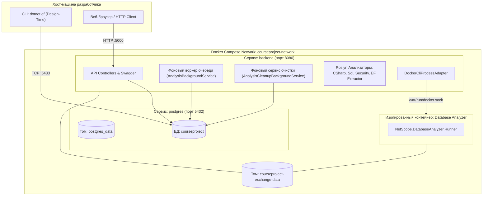

# NetScope (CourseProject)

Система комплексного статического анализа исходного кода C# (.NET 10) и схем реляционных баз данных Entity Framework Core.

---

## Оглавление

- [1. Назначение и возможности](#1-назначение-и-возможности)
- [2. Архитектура и основные компоненты](#2-архитектура-и-основные-компоненты)
- [3. Технологический стек](#3-технологический-стек)
- [4. Системные требования](#4-системные-требования)
- [5. Конфигурация окружения (.env)](#5-конфигурация-окружения-env)
- [6. Генерация криптографических ключей](#6-генерация-криптографических-ключей)
- [7. Сборка и управление контейнерами (Docker Compose)](#7-сборка-и-управление-контейнерами-docker-compose)
- [8. Описание сервисов и портов](#8-описание-сервисов-и-портов)
- [9. Именованные тома Docker (Volumes)](#9-именованные-тома-docker-volumes)
- [10. Миграции Entity Framework Core с хоста](#10-миграции-entity-framework-core-с-хоста)
- [11. Проверка работоспособности (Health Check и Swagger)](#11-проверка-работоспособности-health-check-и-swagger)
- [12. Просмотр логов и мониторинг](#12-просмотр-логов-и-мониторинг)
- [13. Устранение распространённых проблем](#13-устранение-распространённых-проблем)
- [14. Ограничения и известные технические риски](#14-ограничения-и-известные-технические-риски)

---

## 1. Назначение и возможности

**NetScope** — модульная серверная платформа для автоматизированной инспекции качества кода, безопасности и архитектуры баз данных целевых репозиториев C#/.NET.

### Ключевые возможности:
- **Статический анализ C# (Roslyn AST):** проверка размера классов (`CSHARP001`) и длины методов (`CSHARP002`) на уровне абстрактного синтаксического дерева без компиляции и без выполнения стороннего кода.
- **Статический аудит безопасности (Security):** выявление открытых секретов, небезопасных настроек CORS и уязвимостей в конфигурациях.
- **Статический анализ SQL/LINQ:** выявление потенциальных SQL-инъекций (`SQL001` при конкатенации/интерполяции строк в `FromSqlRaw`/`ExecuteSqlRaw`) и неоптимальных запросов (`SQL002` при `SELECT *`).
- **Изолированный анализ схем БД (Database Analyzer DooD):** извлечение метаданных моделей EF Core синтаксическим анализатором Roslyn и их последующая инспекция в изолированном контейнере с валидацией правил реляционного проектирования (`DB01`–`DB05`: первичные ключи, навигационные свойства, промежуточные таблицы связей многие-ко-многим, покрывающие индексы для внешних ключей, дубликаты индексов).
- **Надёжная асинхронная очередь задач:** координация сессий анализа через PostgreSQL с защитой от гонок через session-level advisory locks и механизм распределённой аренды (lease-based queue).
- **Интеграция с GitHub API:** синхронизация коммитов и безопасное хранение персональных токенов доступа (GitHub PAT) с шифрованием AES-256.

---

## 2. Архитектура и основные компоненты

Система спроектирована как модульный монолит в соответствии с принципами чистой слоистой архитектуры (Clean Architecture).



### Слои системы:
- **`src/Backend/Domain`:** базовые доменные сущности (`User`, `Role`, `Project`, `Commit`, `Analysis`, `AnalysisResult`), перечисления (`AnalysisStatus`, `Severity`, `AnalyzerType`) и фундаментальные правила целостности.
- **`src/Backend/Application`:** прикладная бизнес-логика, оркестратор анализа (`AnalysisService`), фоновые сервисы обработки очереди и контракты репозиториев.
- **`src/Backend/Infrastructure`:** реализация доступа к данным через Entity Framework Core (`AppDbContext`), миграции, BCrypt-хэширование паролей, выпуск JWT-токенов, адаптер Docker CLI и криптографическая служба хранения токенов GitHub.
- **`src/Backend/Api`:** контроллеры REST API, настройка аутентификации JWT Bearer, Swagger OpenAPI 3.0 и конечная точка проверки здоровья (`/health`).
- **`src/Analyzers/*`:** библиотеки правил статического анализа (`CSharp`, `Sql`, `Security`, `Database`) и автономный раннер инспекции моделей баз данных `src/Analyzers/Database.Runner`.

### Архитектура изоляции Database Analyzer (Docker-outside-of-Docker):
Анализ моделей БД выполняется в изолированном контейнере `netscope-database-analyzer:latest`, создаваемом сервисом Backend через Docker CLI с подключением к сокету `/var/run/docker.sock`. Контейнер запускается со следующими подтверждёнными механизмами защиты:
- **Пользователь контейнера:** непривилегированный пользователь `appuser` (`--user 10001:10001`), созданный в `infrastructure/docker/Dockerfile.database-analyzer`.
- **Сетевая изоляция:** режим `--network none` (полное отключение сети; контейнер не имеет доступа ни к хосту, ни к внешним сетям, ни к базе данных PostgreSQL).
- **Корневая файловая система:** только для чтения (`--read-only`).
- **Временное файловое пространство:** `--tmpfs /tmp:rw,noexec,nosuid,size=64m` (изолированное хранилище в RAM с запретом исполнения бинарных файлов и сбросом SUID).
- **Сброс привилегий:** `--cap-drop ALL` (сброс всех Linux Capabilities) и `--security-opt no-new-privileges` (запрет эскалации привилегий через suid/sgid).
- **Лимиты ресурсов:** Ограничение использования CPU: `--cpus 1.0` (не более эквивалента одного процессорного ядра), оперативная память `--memory 512m`, ограничение процессов `--pids-limit 64` (защита от fork-bomb).
- **Таймаут исполнения:** жесткий wall-clock лимит 60 секунд с последующим принудительным `docker kill` и `docker rm -f`.
- **Фактический механизм файлового обмена и монтирования:** файловая изоляция **не является абсолютной**. Контейнер получает доступ к данным через подключение подкаталогов сессии в именованном томе `courseproject-exchange-data`:
  - Входной каталог (`/exchange/in/input.json`): монтируется строго в режиме **readonly** (`--mount type=volume,source=...,target=/exchange/in,volume-subpath=...,readonly`). `in` – права `0755`: анализатор может читать содержимое и проходить по каталогу, но не изменять его.
  - Выходной каталог (`/exchange/out`): монтируется в режиме **записи** (`--mount type=volume,source=...,target=/exchange/out,volume-subpath=...`). `out` – права `0777`: анализатор может записывать файлы. По протоколу обмена ожидается формирование `output.json`, однако сами права доступа не ограничивают запись только этим файлом.
  - **Валидация путей монтирования (`ResolveVolumeSubpaths`):** метод адаптера на стороне Backend выполняет валидацию сегментов путей (`runId`), передаваемых в параметр `volume-subpath` Docker CLI, исключая path traversal (последовательности `..`, разделители путей) и предотвращая ошибочное монтирование чужих областей общего Docker-тома. Данная проверка регулирует исключительно формирование параметров монтирования тома при вызове `docker create`, тогда как разграничение файловых операций внутри запущенного контейнера обеспечивается политиками рантайма (`--read-only`, `--tmpfs`).

---

## 3. Технологический стек

- **Платформа:** .NET 10 (C# 13/14).
- **Веб-фреймворк:** ASP.NET Core (.NET 10).
- **СУБД:** PostgreSQL 17 (официальный образ `postgres:17`).
- **ORM:** Entity Framework Core 10 (Npgsql.EntityFrameworkCore.PostgreSQL).
- **Синтаксический анализ:** Microsoft.CodeAnalysis.CSharp (Roslyn 4.x).
- **Контейнеризация:** Docker Engine 24+, Docker Compose v2, Docker CLI 28.5.2.
- **Безопасность:** JWT Bearer (HMAC-SHA256), BCrypt.Net-Next, AES-256 (GCM).
- **Тестирование:** xUnit, Moq, FluentAssertions (автоматизированный набор модульных и интеграционных тестов во всех тестовых сборках проекта).

---

## 4. Системные требования

Перед запуском проекта убедитесь, что на хост-машине установлены:
1. **Docker Engine** (версии 24.0 или выше) и **Docker Compose** (версии 2.20 или выше).
   - Для **Windows**: Docker Desktop с активным бэкендом WSL2.
   - Для **Linux**: Docker Engine с добавлением текущего пользователя в группу `docker`.
2. **Свободные TCP-порты на хосте:**
   - `5000` — HTTP REST API приложения Backend;
   - `5433` — внешний порт PostgreSQL (внутри контейнера `5432`).
3. *(Опционально, только для работы с миграциями на хосте)*:
   - **.NET 10 SDK**;
   - Глобальная утилита EF Core CLI: `dotnet tool install --global dotnet-ef`.

> [!IMPORTANT]
> Локальный запуск приложения через команду `dotnet run` **не поддерживается**. Вся архитектура проекта (включая работу очередей и запуск дочерних контейнеров Database Analyzer через сокет) рассчитана исключительно на исполнение в среде Docker Compose.

---

## 5. Конфигурация окружения (.env)

Конфигурация контейнеров управляется через файл `.env` в корневом каталоге проекта.

Файл `.env` содержит реальные секреты и **строго исключён из Git** (зафиксирован правилом в `.gitignore`).

### Сводная таблица переменных окружения

| Переменная в `.env` | Где используется в `docker-compose.yml` | Читается ли приложением | Назначение | Значение по умолчанию |
| :--- | :--- | :---: | :--- | :--- |
| `POSTGRES_DB` | `environment.POSTGRES_DB` сервиса `postgres` и строка подключения `backend` | Да (через строку подключения) | Имя базы данных PostgreSQL. | `courseproject` |
| `POSTGRES_USER` | `environment.POSTGRES_USER` сервиса `postgres` и строка подключения `backend` | Да (через строку подключения) | Имя пользователя СУБД. | `courseproject` |
| `POSTGRES_PASSWORD` | `environment.POSTGRES_PASSWORD` сервиса `postgres` и строка подключения `backend` | Да (через строку подключения) | Пароль пользователя СУБД. | **Обязателен** (нет значения по умолчанию) |
| `POSTGRES_PORT` | `ports` сервиса `postgres` (`${POSTGRES_PORT:-5433}:5432`) | Нет (порт хоста для СУБД) | Внешний TCP-порт PostgreSQL на хосте. | `5433` |
| `JWT_KEY` | `environment.Jwt__Key` сервиса `backend` | Да (`Jwt:Key`) | Секретный ключ подписи JWT (HMAC-SHA256). | **Обязателен** (проверяется на `null`) |
| `JWT_ISSUER` | `environment.Jwt__Issuer` сервиса `backend` | Да (`Jwt:Issuer`) | Издатель токенов JWT. | `CourseProjectApi` |
| `JWT_AUDIENCE` | `environment.Jwt__Audience` сервиса `backend` | Да (`Jwt:Audience`) | Аудитория токенов JWT. | `CourseProjectClient` |
| `TOKEN_ENCRYPTION_KEY` | `environment.Security__TokenEncryptionKey` сервиса `backend` | Да (`Security:TokenEncryptionKey`) | Ключ шифрования токенов GitHub (AES-256). | **Обязателен** (ровно 32 байта Base64) |
| `SWAGGER_ENABLED` | `environment.Swagger__Enabled` сервиса `backend` | Да (`Swagger:Enabled`) | Включение интерактивного Swagger UI в Production-окружении. | `false` (для локальной разработки: `true`) |
| `DOCKER_GID` | `group_add` сервиса `backend` | Нет (используется Docker daemon) | GID группы `docker` на хосте для доступа к сокету `/var/run/docker.sock`. | `0` |

> [!NOTE]
> Переменная `DOCKER_EXCHANGE_VOLUME` задаётся непосредственно в `docker-compose.yml` (`courseproject-exchange-data`) и не настраивается через `.env`. Переменные `CORS_ALLOWED_ORIGINS` и `LOG_LEVEL` относятся к запланированному Этапу 6 и в текущей версии приложения не используются.

### Пример файла `.env`

Создайте файл `.env` в корне проекта со следующими параметрами:

```dotenv
# ===================================================================
# NetScope Local Environment Configuration (.env)
# ===================================================================

# -------------------------------------------------------------------
# PostgreSQL Database
# -------------------------------------------------------------------
POSTGRES_DB=courseproject
POSTGRES_USER=courseproject
POSTGRES_PASSWORD=your_secure_postgres_password
POSTGRES_PORT=5433

# -------------------------------------------------------------------
# JWT Authentication
# В коде проверяется только наличие значения (null-check). Пустые строки и строки из пробелов отдельно не отклоняются.
# Для обеспечения 256 бит энтропии используйте 64 hex-символа (см. раздел 6).
# -------------------------------------------------------------------
JWT_KEY=replace_this_with_a_secure_jwt_secret_key_at_least_256_bits_entropy
JWT_ISSUER=CourseProjectApi
JWT_AUDIENCE=CourseProjectClient

# -------------------------------------------------------------------
# Security & Token Encryption (AES-256)
# Строго 32 байта после Base64-декодирования (валидируется при старте)
# -------------------------------------------------------------------
TOKEN_ENCRYPTION_KEY=replace_with_base64_encoded_32_byte_key_from_openssl

# -------------------------------------------------------------------
# Swagger OpenAPI Documentation (true / false)
# -------------------------------------------------------------------
SWAGGER_ENABLED=true

# -------------------------------------------------------------------
# Docker DooD Integration (Database Analyzer)
# На Linux: GID группы docker (getent group docker | cut -d: -f3). На Windows: 0.
# -------------------------------------------------------------------
DOCKER_GID=0
```

---

## 6. Генерация криптографических ключей

Для безопасной работы сервиса необходимо сгенерировать криптографически стойкие ключи для параметров `JWT_KEY` и `TOKEN_ENCRYPTION_KEY`.

### 1. Генерация `JWT_KEY` (HMAC-SHA256)

> [!IMPORTANT]
> **Уточнение по энтропии и длине ключа:**
> Требование стандарта RFC 7518 к алгоритму HMAC-SHA256 — не менее 256 бит криптографической энтропии (что эквивалентно 32 случайным байтам).
> **256 бит энтропии нельзя приравнивать к 32 произвольным символам текста.** Произвольная строка из 32 букв и цифр содержит существенно меньше энтропии (~190 бит). Для обеспечения полных 256 бит энтропии 32 байта случайных данных представляются в виде **64 шестнадцатеричных символов (hex)** либо в виде Base64-строки.
>
> В `Program.cs` чтение выполняется через `Encoding.UTF8.GetBytes(jwtKey)`. Приложение проверяет факт наличия значения оператором `?? throw` (проверка на `null`), но **не валидирует минимальную длину ключа и его криптостойкость в коде**. Криптографическая защита JWT целиком обеспечивается корректной генерацией секрета администратором.

- **В Linux / macOS / Git Bash:**
  ```bash
  openssl rand -hex 32
  ```
  *(Генерирует 64 hex-символа с честными 256 битами энтропии)*.

- **В Windows PowerShell:**
  *(Использует криптографически стойкий генератор `RandomNumberGenerator`)*:
  ```powershell
  $bytes = New-Object byte[] 32
  [System.Security.Cryptography.RandomNumberGenerator]::Create().GetBytes($bytes)
  [System.BitConverter]::ToString($bytes).Replace('-', '').ToLowerInvariant()
  ```

### 2. Генерация `TOKEN_ENCRYPTION_KEY` (AES-256)

> [!CAUTION]
> Значение `TOKEN_ENCRYPTION_KEY` строго проверяется в `Program.cs`: декодированный из Base64 массив должен содержать **ровно 32 байта**. Строка некорректного формата или иной длины вызовет ошибку `InvalidOperationException` и аварийную остановку Backend.

- **В Linux / macOS / Git Bash:**
  ```bash
  openssl rand -base64 32
  ```

- **В Windows PowerShell:**
  ```powershell
  $bytes = New-Object byte[] 32
  [System.Security.Cryptography.RandomNumberGenerator]::Create().GetBytes($bytes)
  [Convert]::ToBase64String($bytes)
  ```

Скопируйте сгенерированные строки в соответствующие параметры файла `.env`.

---

## 7. Сборка и управление контейнерами (Docker Compose)

Процесс сборки и запуска разделён на две независимые операции: создание Docker-образов и координацию запуска контейнеров.

### Операция 1. Сборка Docker-образов
Команда `docker compose build` выполняет сборку локальных образов согласно инструкциям Dockerfile:
1. Сервис `database-analyzer-build`: собирает автономный образ `netscope-database-analyzer:latest` по файлу `infrastructure/docker/Dockerfile.database-analyzer` (без зависимостей от сборок бэкенда, Zero Shared Code);
2. Сервис `backend`: собирает образ API по многоэтапному файлу `infrastructure/docker/Dockerfile`, включая интеграцию статического бинарника Docker CLI 28.5.2.

```bash
# Сборка всех образов проекта:
docker compose build

# Чистая сборка без использования кэша:
docker compose build --no-cache

# Изолированная пересборка только образа Database Analyzer:
docker compose build database-analyzer-build
```

### Операция 2. Запуск сервисов и координация готовности
При выполнении команды запуска:
```bash
docker compose up -d
```

Docker Compose координирует запуск сервисов в соответствии с объявленными условиями `depends_on`:
- **Параллельный запуск зависимостей:** Сервисы `database-analyzer-build` и `postgres` не имеют зависимостей между собой и могут запускаться Docker Compose параллельно:
  - `database-analyzer-build`: запускается однократный контейнер `courseproject-database-analyzer-build` (`restart: "no"`), который выводит сообщение `netscope-database-analyzer:latest image is ready` и завершается с кодом 0 (`service_completed_successfully`), подтверждая наличие локального образа раннера;
  - `postgres`: запускается контейнер СУБД PostgreSQL 17 и ожидает перехода в состояние `healthy` по результатам встроенного healthcheck (`pg_isready`).
- **Запуск основного сервиса `backend`:** контейнер `courseproject-backend` ожидает выполнения обоих условий и стартует только после того, как сервис `database-analyzer-build` успешно завершился с кодом 0, а контейнер `postgres` перешёл в статус `healthy`.

### Проверка состояния контейнеров
```bash
docker compose ps
```
Контейнеры `courseproject-postgres` и `courseproject-backend` должны иметь статус `Up (healthy)` (оба сервиса содержат встроенные проверки healthcheck в `docker-compose.yml`). Служебный контейнер `courseproject-database-analyzer-build` находится в статусе `Exited (0)`.

### Остановка сервисов
- **Штатная остановка с сохранением данных:**
  ```bash
  docker compose down
  ```
  Останавливает и удаляет контейнеры, но **сохраняет** тома `postgres_data` и `courseproject-exchange-data`.

- **Перезапуск сервисов:**
  ```bash
  docker compose restart
  ```

---

## 8. Описание сервисов и портов

| Сервис | Имя контейнера | Внутренний порт | Внешний порт хоста | Назначение |
| :--- | :--- | :---: | :---: | :--- |
| `postgres` | `courseproject-postgres` | `5432` | `${POSTGRES_PORT:-5433}` | СУБД PostgreSQL 17. Хранение пользователей, проектов, очереди анализов и замечаний. |
| `database-analyzer-build` | `courseproject-database-analyzer-build` | — | — | Служебный контейнер регистрации готовности образа `netscope-database-analyzer:latest`. |
| `backend` | `courseproject-backend` | `8080` | `5000` | Веб-сервер ASP.NET Core, REST API, оркестратор очереди и синтаксические Roslyn-анализаторы. |

---

## 9. Именованные тома Docker (Volumes)

Проект использует два изолированных именованных тома:

1. **`postgres_data`:**
   - **Точка монтирования:** `/var/lib/postgresql/data` в контейнере `postgres`.
   - **Назначение:** Персистентное хранилище таблиц, индексов и журналов WAL СУБД PostgreSQL. Данные сохраняются между перезапусками контейнеров.
2. **`netscope_exchange` (имя тома: `courseproject-exchange-data`):**
   - **Точка монтирования:** `/tmp/netscope-database-analyzer` в контейнере `backend`.
   - **Назначение:** Изолированный том для межконтейнерного файлового обмена (DooD) между Backend и динамически порождаемыми контейнерами `netscope-database-analyzer`. Внутри тома создаются изолированные подкаталоги сессий `{analysisId}_{executionToken}/in` и `out`.

> [!CAUTION]
> **Разрушительные последствия команды `docker compose down -v`:**
> Флаг `-v` (`--volumes`) приводит к **безвозвратному удалению всех именованных томов проекта**.
> Будут навсегда удалены база данных PostgreSQL (`postgres_data`) со всеми учётными записями, проектами и историей анализов, а также том обмена данными анализатора (`courseproject-exchange-data`)!

---

## 10. Миграции Entity Framework Core с хоста

### Автоматическая инициализация при старте
При запуске контейнера Backend сервис `DatabaseInitializer` **автоматически накатывает все ожидающие миграции EF Core** и выполняет посев обязательных системных ролей (`Admin`, `User`). Ручное применение миграций для запуска не требуется.

### Выполнение миграций с хост-машины (Design-Time Tooling)
Если в процессе разработки требуется создать новую миграцию, проверить статус схемы или применить миграцию с хоста через инструмент `dotnet ef`, подключение выполняется к опубликованному порту PostgreSQL `5433`.

Строка подключения передаётся в `dotnet ef` через стандартную переменную окружения `ConnectionStrings__DefaultConnection`:

#### В Windows PowerShell:
```powershell
$env:ConnectionStrings__DefaultConnection="Host=localhost;Port=5433;Database=courseproject;Username=courseproject;Password=your_secure_postgres_password"

# Применение миграций:
dotnet ef database update --project src/Backend/Infrastructure --startup-project src/Backend/Api

# Создание новой миграции (при изменении доменных сущностей):
dotnet ef migrations add <ИмяМиграции> --project src/Backend/Infrastructure --startup-project src/Backend/Api
```

#### В Linux / macOS / Bash:
```bash
export ConnectionStrings__DefaultConnection="Host=localhost;Port=5433;Database=courseproject;Username=courseproject;Password=your_secure_postgres_password"

# Применение миграций:
dotnet ef database update --project src/Backend/Infrastructure --startup-project src/Backend/Api

# Создание новой миграции:
dotnet ef migrations add <ИмяМиграции> --project src/Backend/Infrastructure --startup-project src/Backend/Api
```

---

## 11. Проверка работоспособности (Health Check и Swagger)

### 1. Проверка состояния API и базы данных (Health Check)
```bash
curl -f http://localhost:5000/health
```
**Ожидаемый ответ:** `Healthy` (HTTP 200 OK).

### 2. Интерактивная документация Swagger UI
Если в `.env` включён параметр `SWAGGER_ENABLED=true`, документация OpenAPI 3.0 доступна по адресу:
- **URL:** [http://localhost:5000/swagger](http://localhost:5000/swagger)

### 3. Проверка готовности PostgreSQL через Docker CLI
```bash
docker compose exec postgres pg_isready -U courseproject -d courseproject
```
**Ожидаемый ответ:** `courseproject:5432 - accepting connections`.

---

## 12. Просмотр логов и мониторинг

- **Логи всех сервисов Compose в реальном времени:**
  ```bash
  docker compose logs -f
  ```
- **Логи только Backend (API и фоновые очереди анализа):**
  ```bash
  docker compose logs -f backend
  ```
- **Логи базы данных PostgreSQL:**
  ```bash
  docker compose logs -f postgres
  ```

---

## 13. Устранение распространённых проблем

### 1. Ошибка доступа к Docker сокету (`Permission denied /var/run/docker.sock`)
- **Симптом:** В логах `backend` появляется ошибка при попытке запуска `DatabaseAnalyzer`: `Cannot connect to the Docker daemon at unix:///var/run/docker.sock` или `Permission denied`.
- **Решение:**
  - На Linux убедитесь, что в файле `.env` переменная `DOCKER_GID` установлена в реальный GID группы `docker` хоста (`getent group docker | cut -d: -f3`). Перезапустите контейнеры: `docker compose up -d`.
  - На Windows убедитесь, что в настройках Docker Desktop активна интеграция с используемым дистрибутивом WSL2.

### 2. Контейнер `backend` аварийно завершается с ошибкой `Security:TokenEncryptionKey`
- **Симптом:** `InvalidOperationException: Ключ шифрования токенов 'Security:TokenEncryptionKey' имеет некорректный формат Base64` либо длина не равна 32 байтам.
- **Решение:** Сгенерируйте корректный 32-байтный ключ через `openssl rand -base64 32` и обновите `TOKEN_ENCRYPTION_KEY` в файле `.env`.

### 3. Конфликт внешних портов `5000` или `5433` на хосте
- **Симптом:** Ошибка при старте Compose: `Bind for 0.0.0.0:5433 failed: port is already allocated`.
- **Решение:**
  - Для PostgreSQL: измените внешний порт в `.env`, например `POSTGRES_PORT=5434`, и используйте его при вызовах `dotnet ef`.
  - Для Backend: освободите хостовый порт 5000 (остановите конфликтующие локальные сервисы).

### 4. Ошибка отсутствия образа Database Analyzer
- **Симптом:** Backend сообщает, что образ `netscope-database-analyzer:latest` не найден при попытке запуска контейнера.
- **Решение:** Выполните принудительную пересборку образа раннера:
  ```bash
  docker compose build database-analyzer-build
  ```

---

## 14. Ограничения и известные технические риски

1. **Накопление данных в именованном томе `courseproject-exchange-data`:**
   Именованный том обмена сохраняется на хосте между перезапусками `docker compose down`. Если в процессе исполнения анализа возникло расхождение токенов, каталог сессии намеренно сохраняется для отладки. Периодически выполняйте ревизию тома либо очищайте его при пересоздании среды через `docker compose down -v`.
2. **Временные каталоги в Writable Layer контейнера Backend:**
   Рабочие копии анализируемых репозиториев размещаются в каталоге `/tmp/CourseProject/analyses` в writable layer контейнера `backend`. При падении Backend до фиксации задачи в БД эти файлы не обнаруживаются сервисом `AnalysisCleanupService` и удаляются только при остановке контейнера через `docker compose down`.
3. **Задержка освобождения PostgreSQL Advisory Locks при сетевых сбоях:**
   Сессионные блокировки `pg_try_advisory_lock` удерживаются сервером СУБД. При тихом разрыве связи без отправки пакетов закрытия сокета (FIN/RST) блокировка остаётся активной до истечения таймаутов TCP keepalive PostgreSQL, что может временно откладывать повторный захват упавшей задачи воркером очереди.
4. **Валидация конфигурации JWT в `Program.cs`:**
   Проверка `Jwt:Key` в коде выполняется оператором `?? throw` (проверка на `null`), который не отклоняет пустые строки `""` или строки из пробелов и не валидирует минимальную длину ключа. Качество защиты полностью опирается на корректность генерации секрета при настройке `.env`.
