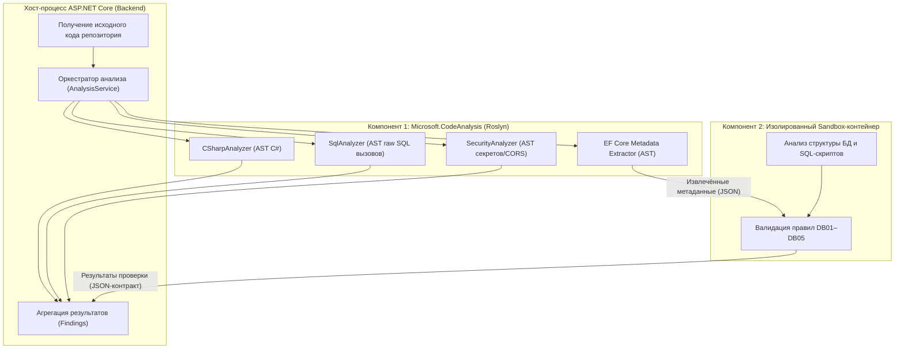

# ADR-001: Архитектура анализаторов, изоляция анализа БД и отказоустойчивость конвейера

**Статус документа:** `ACCEPTED (Архитектурное решение утверждено / Реализация не начата)`
**Дата утверждения:** 06 ноября 2026 г.
**Связанные дефекты:** [DEF-001](../audits/2026-11-06-technical-audit.md#def-001-выполнение-недоверенного-msbuild-кода-и-динамическая-загрузка-сборки), [DEF-002](../audits/2026-11-06-technical-audit.md#def-002-сбой-всего-анализа-коммита-при-отсутствии-idesigntimedbcontextfactory), [DEF-003](../audits/2026-11-06-technical-audit.md#def-003-изоляция-рабочих-каталогов-анализа-по-токену-выполнения-и-безопасная-очистка)
**Связанные задачи плана техдолга:** [TD-001](../plans/Technical-Debt-Plan.md#td-001), [TD-002](../plans/Technical-Debt-Plan.md#td-002), [TD-003](../plans/Technical-Debt-Plan.md#td-003)

> [!IMPORTANT]
> **Статус реализации:** Архитектурные решения согласованы и утверждены. В текущей кодовой базе ревизии `2068c51` реализация ещё не начата (в исходниках сохраняется промежуточная реализация инспектора моделей `EfCoreModelInspector.cs` с динамической загрузкой сборок через `Assembly.LoadFrom`). Настоящий документ фиксирует нормативные требования для выполнения задач `TD-001`, `TD-002` и `TD-003`.

---

## 1. Контекст и проблематика

Историческая реализация компонента `DatabaseAnalyzer` (`src/Analyzers/Database/Providers/EfCoreModelInspector.cs`) для получения метаданных сущностей, ключей, навигаций и индексов выполняла следующие небезопасные операции:
1. Запускала системный процесс `Process.Start("dotnet", $"build \"{projectPath}\"")` для компиляции исследуемого проекта пользователя;
2. Загружала скомпилированную сборку `.dll` вызовом `Assembly.LoadFrom(assemblyPath)`;
3. Выполняла поиск класса, реализующего интерфейс `IDesignTimeDbContextFactory<T>`, создавала его экземпляр через `Activator.CreateInstance` и вызывала `CreateDbContext` для извлечения `IModel`.

### Выявленные критические риски (DEF-001, DEF-002, DEF-003):
1. **Remote Code Execution (RCE) на хосте (DEF-001):** В файлах `.csproj`, `.props` или `.targets` анализируемого репозитория могут быть определены сборочные таргеты `<Exec Command="..." />` или inline-задачи C#, которые исполняются операционной системой хоста с полными правами процесса бэкенда.
2. **Неконтролируемое исполнение стороннего кода (DEF-001):** При загрузке сборки и создании экземпляра фабрики выполняются статические конструкторы (`.cctor`), конструкторы классов и пользовательский код внутри основного процесса сервера.
3. **Неустранимая утечка памяти CLR (DEF-001):** Метод `Assembly.LoadFrom` загружает сборку в `AssemblyLoadContext.Default`. В .NET Core / .NET такие сборки **не могут быть выгружены из памяти**. При длительной работе сервера память процесса монотонно растет, а совпадение имен зависимостей вызывает коллизии типов (`TypeLoadException`).
4. **Хрупкость инспекции и аварийный сбой анализа коммита (DEF-002):** Подавляющее большинство реальных проектов ASP.NET Core регистрирует `DbContext` через `builder.Services.AddDbContext<AppDbContext>()` и не содержит фабрики `IDesignTimeDbContextFactory<T>`. Инспектор выбрасывает исключение `InvalidOperationException`, которое в текущей версии роняет весь анализ коммита, теряя результаты остальных анализаторов.
5. **Гонка временных каталогов и удаление рабочих файлов (DEF-003):** Рабочий каталог формируется без учета токена выполнения (`data/analysis/{analysisId}`). При истечении аренды новый воркер начинает обработку в том же каталоге, а старый воркер в блоке `catch` метода `DownloadAndExtractAsync` безусловно удаляет каталог, нарушая работу нового воркера.

---

## 2. Согласованная архитектура анализаторов: зоны ответственности

Принципиальное архитектурное решение: **Roslyn и изолированный контейнер — это не два конкурирующих альтернативных способа решения одной задачи, а два самостоятельных взаимодополняющих компонента с чётким разделением зон ответственности**.



### 2.1. Зона ответственности Roslyn — статический анализ исходного кода C#

Roslyn отвечает за статический анализ исходного кода C# без компиляции проектов и без динамической загрузки сторонних сборок в процесс сервера.

**Устранение векторов исполнения кода и границы безопасности:**
Отказ от `dotnet build`, сборочных таргетов MSBuild и загрузки сборок через `Assembly.LoadFrom` устраняет конкретные векторы исполнения пользовательского кода в основном процессе бэкенда Отказ от загрузки пользовательских сборок в `AssemblyLoadContext.Default` исключает прежний механизм накопления невыгружаемых пользовательских сборок. Это не является гарантией отсутствия любых утечек памяти CLR. При этом синтаксический анализ Roslyn не декларируется как абсолютная безопасность: для защиты от атак на отказ в обслуживании (DoS) через чрезмерно глубокие AST-деревья или циклические конструкции вводятся строгие ограничения по времени, памяти и глубине обхода.

**Обязанности Roslyn:**
1. Статический синтаксический анализ исходного кода C# на базе абстрактных синтаксических деревьев (AST).
2. Анализ проектов без вызова `dotnet build` и без необходимости успешного восстановления NuGet-пакетов (`dotnet restore`).
3. Возможность анализа неполных, синтаксически повреждённых или некомпилируемых проектов.
4. Извлечение метаданных Entity Framework Core непосредственно из исходного C#-кода:
   - обнаружение классов, наследующих `DbContext`;
   - обнаружение свойств `DbSet<TEntity>` в контекстах данных;
   - обнаружение и разбор классов конфигураций `IEntityTypeConfiguration<TEntity>`.
5. Анализ декларативных атрибутов Data Annotations (строго согласованный перечень):
   - `[Key]` — первичный ключ;
   - `[ForeignKey("...")]` — внешний ключ и имя навигационного свойства;
   - `[Index(nameof(...), IsUnique = ...)]` — одиночные и составные индексы;
   - `[Table("...", Schema = "...")]` — сопоставление таблицы и схемы;
   - `[Required]` — признак обязательности поля (NOT NULL).
6. Анализ поддерживаемых цепочек Fluent API в методах `OnModelCreating` и `Configure` (строго согласованный перечень):
   - `HasKey(x => x.Id)` и составные ключи `HasKey(x => new { x.A, x.B })`;
   - `HasIndex(x => x.Prop)` с последующими вызовами `.IsUnique()`, `.HasDatabaseName(...)`, `.HasFilter(...)`;
   - Отношения связности: `HasOne`, `WithMany`, `WithOne`, `HasMany`, `HasForeignKey`;
   - Конфигурация таблиц: `ToTable("...", "...")`.
   - **Регистрация конфигураций (`ApplyConfiguration` и `ApplyConfigurationsFromAssembly`):** поддерживается статический поиск только тех типов `IEntityTypeConfiguration<TEntity>`, которые явно объявлены в анализируемом синтаксическом дереве исходного кода. Произвольная динамическая регистрация конфигураций (через рефлексию во время выполнения, сканирование внешних сборок или runtime-фабрики) не поддерживается. Если состав конфигураций невозможно достоверно определить статически по синтаксическому дереву, формируется предупреждение `Severity.Warning`.
7. Раздельный анализ нескольких `DbContext`: если в репозитории обнаружено несколько классов `DbContext`, метаданные для каждого контекста формируются строго раздельно (предотвращается смешивание моделей разных контекстов).
8. **Статический обход локальных вспомогательных методов конфигурации:**
   - Максимальная глубина обхода строго зафиксирована: **не более 3 уровней**.
   - Обход выполняется только для статически обнаруживаемых локальных методов в пределах классов конфигурации и `DbContext`.
   - Обязательно реализуется защита от рекурсивных циклов.
   - При невозможности достоверного статического анализа (динамический диспатчинг, вызов методов сторонних сборок, циклическая рекурсия) формируется диагностическое предупреждение `Severity.Warning`.
9. **Строгие границы поддерживаемых конструкций:**
   - Состав поддерживаемых конструкций ограничен исключительно согласованным перечнем Fluent API и Data Annotations.
   - Не расширять состав поддерживаемых конструкций сверх согласованного объёма. Любые неподдерживаемые конструкции, динамическая рефлексия или сторонние методы расширения генерируют предупреждение `Severity.Warning` о неполноте извлечённых метаданных.
10. **Запрет выполнения пользовательского кода в процессе backend:** Roslyn не выполняет сборку, не исполняет MSBuild-таргеты, не загружает сборки в память и не исполняет статические конструкторы (`.cctor`) или методы пользовательского кода.

### 2.2. Зона ответственности изолированного контейнера — анализ БД и SQL

Контейнер отвечает за изолированное выполнение ресурсоёмких операций анализа, связанных со структурами баз данных и SQL, на основе подготовленных входных данных.

**Границы работы контейнера и отсутствие сетевого подключения к СУБД:**
- Контейнер категорически **не подключается к пользовательской или рабочей PostgreSQL по сети**. Флаг `--network none` действует по умолчанию и является обязательным.
- На вход контейнеру передаются подготовленные файлы: файлы SQL/DDL-описаний и миграций, извлечённые Roslyn метаданные моделей EF Core и параметры проверки (через read-only том или `tmpfs`).
- Анализ физической структуры выполняется исключительно на основании переданных входных данных с использованием встроенных в контейнер локальных утилит и валидаторов.
- Передача любых серверных секретов бэкенда (строки подключения, JWT-секреты, токены) в контейнер строго запрещена.
- Если на дальнейших этапах развития потребуется подключение к реальной СУБД (например, временной эфемерной базе в тестовом контуре), это должно быть оформлено и согласовано как **отдельное архитектурное решение (ADR)**.

**Обязанности изолированного контейнера:**
1. Анализ физической структуры реляционной базы данных и реляционных схем на основе переданных DDL/SQL-скриптов.
2. Проверка таблиц, столбцов, типов данных, первичных и внешних ключей.
3. Проверка индексов, уникальности, условий фильтрации, ограничений целостности (constraints) и каскадных правил.
4. Анализ файлов SQL-скриптов, DDL-описаний и файлов миграций.
5. При необходимости — выполнение специализированных проверок с использованием локальных утилит анализа схем внутри контейнера.
6. Получение файла метаданных EF Core, сформированного компонентом Roslyn, и проведение инспекции правил проектирования реляционной модели (`DB01`–`DB05`).
7. **Чёткая граница с `SqlAnalyzer`:** существующий легковесный статический анализ вызовов EF Core в C# коде (`SQL001` — строковая конкатенация/интерполяция в `FromSqlRaw`/`ExecuteSqlRaw`, `SQL002` — выборка `SELECT *`) остаётся в `SqlAnalyzer` на базе Roslyn AST. Контейнер не дублирует эти синтаксические проверки, а привлекается для задач, требующих специализированного реляционного инструментария или работы с SQL-движком.

### 2.3. Требования безопасности изолированного контейнера (Критерии реализации)

Контейнер изолирован от хост-процесса ASP.NET Core и подчиняется следующим обязательным требованиям безопасности:
- **Лимиты вычислительных ресурсов:** жесткое ограничение процессорного времени (`--cpus="1.0"`) и оперативной памяти (`--memory="512m"`).
- **Ограничение времени работы (Timeout):** таймаут выполнения операций анализа в контейнере (не более 60 секунд на задачу).
- **Изоляция секретов:** строгий запрет передачи в контейнер любых переменных окружения хоста, секретов бэкенда, токенов доступа GitHub и строк подключения к PostgreSQL.
- **Изоляция файловой системы:** монтирование корневой файловой системы в режиме `read-only` (`--read-only`), использование ограниченного временного хранилища `tmpfs` (`--tmpfs /tmp:rw,noexec,nosuid,size=64m`).
- **Сетевая изоляция:** полное отключение сетевых интерфейсов по умолчанию (`--network none`). Контейнер не имеет сетевого доступа к хосту, внешней сети или серверам баз данных.
- **Минимизация доступа к данным:** монтирование только каталога подготовленных входных данных конкретной задачи в режиме `read-only` (`-v /temp/path:/input:ro`).
- **Выделенный независимый контракт обмена данными (JSON):** контейнер возвращает результаты работы в виде структурированного JSON по отдельному, независимому контракту обмена (DTO / JSON Schema). Зависимость контейнера от внутренних классов, доменных моделей и сборок бэкенда (`AnalyzerFinding`, `Severity`, `AnalyzerType` и др.) категорически исключена. Приём, валидация JSON и преобразование данных во внутренние объекты `AnalyzerFinding` для сохранения в базе данных выполняются исключительно на стороне бэкенда.
- **Изоляция окружения хоста:** запуск под непривилегированным пользователем (`--user 10001:10001`), сброс привилегий (drop capabilities). Контейнеризация не даёт гарантий абсолютной безопасности, но обеспечивает надежную изоляцию выполнения инструментов анализа от основного процесса сервера.
- **Автоматическая очистка ресурсов:** гарантированное удаление контейнера и временных ресурсов сразу после завершения работы (`--rm`).

---

## 3. Схема взаимодействия компонентов

1. Сервис бэкенда (`AnalysisBackgroundService`) извлекает задачу из очереди и скачивает проект во временный изолированный каталог.
2. Roslyn-модули параллельно выполняют статический анализ исходного кода C#:
   - `CSharpAnalyzer` анализирует синтаксические деревья C#;
   - `SqlAnalyzer` проверяет обращения к сырым методам SQL;
   - `SecurityAnalyzer` сканирует код на предмет открытых секретов и опасных настроек;
   - Экстрактор метаданных EF Core на базе Roslyn строит объектную модель метаданных схемы (`DatabaseMetadata`).
3. Метаданные EF Core и SQL-скрипты передаются изолированному контейнеру анализа БД.
4. Контейнер проверяет правила проектирования схемы базы данных на основе входных данных и возвращает структурированный JSON-отчёт по независимому контракту обмена.
5. Бэкенд валидирует полученный JSON, выполняет маппинг во внутренние объекты `AnalyzerFinding` и сохраняет замечания в БД.
6. **Отказоустойчивость:** сбой одного из анализаторов не приводит к потере результатов остальных модулей.

---

## 4. Архитектурное решение по TD-002: Отказоустойчивость конвейера анализа

1. **Изоляция сбоев (Partial Success):** Невозможность анализа базы данных (например, проект не содержит `DbContext` или использует неподдерживаемую динамическую генерацию) **не должна переводить весь анализ коммита в статус `Failed`**, если остальные анализаторы (`CSharpAnalyzer`, `SqlAnalyzer`, `SecurityAnalyzer`) успешно завершили работу.
2. **Сохранение результатов:** Результаты всех успешно завершившихся анализаторов сохраняются в таблице `"AnalysisResults"`. Общий статус задачи в очереди переходит в `Completed`.
3. **Информирование пользователя:** При возникновении проблем с инспекцией БД пользователю возвращается диагностическое замечание `AnalyzerFinding` с уровнем `Severity.Warning`, содержащее подробное описание причины и рекомендации по исправлению.
4. **Типизация причин сбоя анализатора БД:**
   - `MISSING_DBCONTEXT` — в проекте не найдено ни одного контекста Entity Framework Core;
   - `UNSUPPORTED_FLUENT_API` — использованы неподдерживаемые конструкции конфигурации модели;
   - `SYNTAX_ERROR` — в файлах конфигурации модели присутствуют синтаксические ошибки;
   - `AMBIGUOUS_MODEL` — обнаружены противоречивые настройки сущностей;
   - `CONTAINER_TIMEOUT` / `CONTAINER_ERROR` — превышение лимитов ресурсов или сбой контейнера;
   - `INTERNAL_ANALYZER_ERROR` — непредвиденная внутренняя ошибка анализатора.
5. **Сохранение частичных метаданных и защита от ложных срабатываний:**
   - Если часть метаданных извлечена достоверно, она сохраняется;
   - **Запрещено** запускать правила `DB01`–`DB05` на заведомо неполной модели, если это может породить ложные срабатывания (например, рапортовать об отсутствии первичного ключа `DB01`, если метод конфигурации ключа не был распознан). Запускаются только те проверки, для которых имеющихся данных достаточно.
6. **Запрет подмены провайдера на SQLite in-memory:** Категорически запрещается использовать создание контекста через SQLite in-memory (`UseSqlite`), так как специфичные для PostgreSQL типы и конструкции Npgsql вызывают исключения несовместимости типов.

---

## 5. Архитектурное решение по TD-003: Изоляция рабочих каталогов и безопасная очистка

1. **Иерархическая структура каталогов:**
   Каждое исполнение задачи анализа изолируется в отдельном подкаталоге:
   ```
   {Storage:AnalysisPath}/{AnalysisId}/{ExecutionToken}/
   ```
2. **Конфигурация пути хранилища:**
   - Путь настраивается через конфигурационный параметр: `Storage:AnalysisPath`;
   - Значение по умолчанию: `Path.Combine(Path.GetTempPath(), "CourseProject", "analyses")`;
   - **Запрещено** использовать каталог сборки приложения `AppContext.BaseDirectory` для размещения рабочих данных анализа.
3. **Сквозная передача `ExecutionToken`:**
   Уникальный идентификатор исполнения `Guid executionToken` передаётся через все этапы жизненного цикла:
   - скачивание архива репозитория;
   - контролируемая распаковка;
   - формирование путей контекста `AnalyzerContext.RepositoryPath`;
   - работа анализаторов и контейнера;
   - очистка временных ресурсов.
4. **Запрет очистки по `AnalysisId`:** Очистка каталогов строго по `AnalysisId` без указания `ExecutionToken` запрещена во всех сервисах (`RepositorySourceService`, `AnalysisService`).
5. **Правила немедленной очистки:**
   - При успешном завершении анализа рабочий каталог `{AnalysisId}/{ExecutionToken}` немедленно удаляется в блоке `finally`;
   - При штатной ошибке анализа рабочий каталог также немедленно удаляется в блоке `finally`;
   - Каждый рабочий процесс имеет право удалять **только свой собственный каталог**, соответствующий его `ExecutionToken`.
6. **Защита от гонок при потере аренды (Lease Expiration):**
   Если аренда задачи истекла и воркер B начал выполнение с новым `ExecutionToken`, каталог воркера B расположен по пути `{AnalysisId}/{TokenB}`. Завершающийся воркер A удаляет только каталог `{AnalysisId}/{TokenA}`, что полностью исключает удаление файлов активного воркера B.
7. **Фоновая очистка осиротевших каталогов (Orphan Cleanup) и устранение гонок:**
   - Фоновая очистка является проектным требованием задачи `TD-003`, **ещё не реализована в кодовой базе и требует отдельного проектирования, разработки и тестирования**.
   - **Удаление каталогов исключительно по возрасту (TTL) категорически запрещено:** истечение TTL или отсутствие каталога в промежуточных запросах является лишь предварительным фильтром кандидатов на проверку, но не самостоятельным основанием для удаления.
   - **Единый протокол сессионных advisory locks для синхронизации воркеров и очистки:**
     * Рабочий процесс получает `pg_advisory_lock_shared` для `AnalysisId` и удерживает блокировку на протяжении всех файловых операций с каталогом.
     * После получения `pg_advisory_lock_shared` рабочий процесс обязан повторно проверить в PostgreSQL, что его `ExecutionToken` по-прежнему является актуальным для соответствующего `AnalysisId`. Только после успешной проверки разрешается создавать, распаковывать, читать или изменять файлы рабочего каталога.
     * Если токен больше не актуален или состояние БД невозможно достоверно проверить, воркер обязан освободить блокировку и прекратить выполнение без файловых операций.
     * Очистка получает эксклюзивный `pg_advisory_lock` для того же `AnalysisId`.
     * После получения эксклюзивной блокировки очистка повторно проверяет текущий `ExecutionToken` в БД.
     * **Критерий удаления устаревшей директории:** в БД хранится только актуальный `ExecutionToken`. Удалять разрешается только директорию, токен которой отличается от актуального токена. Директорию актуального запуска удалять запрещено.
     * При потере соединения с БД рабочий процесс немедленно прекращает файловые операции. Очистка при потере соединения или блокировки прекращает удаление.
     * Блокировка должна удерживаться на протяжении всей соответствующей файловой операции.
     * Если состояние БД или владение блокировкой невозможно достоверно проверить, удаление не выполняется, а проверка повторяется в следующем цикле.

---

## 6. Матрица статуса архитектурных решений

| Задача | Архитектурное решение | Статус согласования | Статус в кодовой базе |
| :--- | :--- | :---: | :---: |
| **TD-001** | Roslyn AST для C#/EF Core + Sandbox-контейнер для БД/SQL | **ACCEPTED** | *Ожидает реализации* |
| **TD-002** | Отказоустойчивость конвейера, частичный успех, типизация ошибок | **ACCEPTED** | *Ожидает реализации* |
| **TD-003** | Путь `{Storage:AnalysisPath}/{AnalysisId}/{ExecutionToken}`, сквозной токен, очистка в `finally` | **ACCEPTED** | *Ожидает реализации* |
