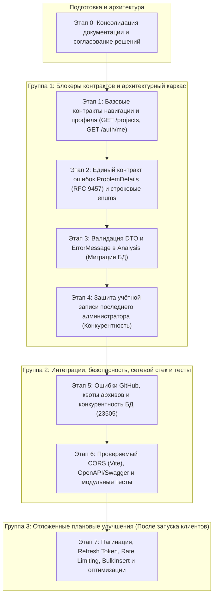

# Единый план технической стабилизации REST API проекта CourseProject

**Документ:** План технической стабилизации и подготовки серверного API перед началом разработки клиентских приложений<br/>
**Версия документа:** 1.4.0<br/>
**Дата актуализации:** 30 октября 2026 г.<br/>
**Базовый коммит:** `9f7992e` (*fix: handle duplicate project names and secure integration tests*)<br/>
**Статус исходного кода:** Не изменялся (этап аудита, фиксации архитектурных решений и согласования документации)

---

## 1. Цели стабилизации API

Главная цель стабилизации — гарантировать, что серверный REST API проекта CourseProject является **надежным, безопасным, предсказуемым и достаточным** для автономной разработки независимых клиентов:
- Консольный клиент (CLI) на .NET 10 / Spectre.Console;
- Настольное приложение (Desktop) на Tauri / React / TypeScript;
- Телеграм-бот (Bot) на .NET 10 / Telegram.Bot.

Стабилизация исключает необходимость изменения контрактов сервера в процессе клиентской разработки.

### Зафиксированные целевые решения:
1. **Устранить разрывы навигации и профиля:** реализовать базовые эндпоинты получения данных текущего пользователя (`GET /api/auth/me`) и списка проектов (`GET /api/projects`) без необходимости декодирования JWT-токенов на клиентах.
2. **Внедрить единый расширенный контракт ошибок (`ProblemDetails` по стандарту RFC 9457):** все ошибки (аутентификации, авторизации, маршрутизации, валидации, конфликтов данных, внешних интеграций и необработанных исключений) возвращаются в строго типизированном виде с обязательными полями `status`, `title`, `detail`, `instance`, `code`, `traceId`. Поле `errors` со словарем сообщений валидации присутствует исключительно при коде `400 Bad Request` (`VALIDATION_FAILED`). Внутренние исключения, стек вызовов, параметры SQL и пути файловой системы клиенту никогда не передаются, а фиксируются в серверном журнале с привязкой к `traceId`.
3. **Зафиксировать строковую сериализацию перечислений (`JsonStringEnumConverter`):** так как внешних клиентов на данный момент нет, обратная совместимость с числовыми индексами не требуется. Все публичные перечисления (`AnalysisStatus`, `Severity`, `AnalyzerType`) сериализуются строковыми значениями (`"Completed"`, `"Warning"`, `"CSharp"`), что исключает ошибки при изменении порядковых номеров значений.
4. **Обеспечить многоуровневую защиту и валидацию данных:** внедрить строгую валидацию входных DTO через атрибуты `DataAnnotations` с русскоязычными сообщениями, защитить файловую систему сервера окончательно зафиксированными проектными квотами на распаковку архивов от DoS и Zip-бомб (поточный контроль размера отдельного файла, суммарного извлеченного объема и числа файлов с обязательной очисткой в `finally`).
5. **Выделить защиту учетной записи последнего администратора в самостоятельный этап:** гарантировать на уровне бизнес-логики (`UserService`, `UserRepository`) невозможность удаления или понижения роли последней активной учетной записи с ролью `Admin`, включая обязательную защиту от состояния гонки (race conditions) при параллельных запросах.
6. **Обеспечить надежность интеграций и конкурентности:** транслировать ошибки GitHub API в корректные HTTP-статусы с отдельной проверкой заголовков лимитов (`X-RateLimit-*`), перехватывать ошибки уникальности PostgreSQL `23505` с возвратом `409 Conflict`, реализовать дедупликацию активных задач анализа.
7. **Сохранять и отображать причину сбоя анализа:** расширить доменную сущность `Analysis` и DTO `AnalysisDto` полем `ErrorMessage`, создать целевую миграцию EF Core (на этапе реализации после верификации фактической модели), и безопасно сохранять русскоязычную причину ошибки без утечки внутренних стектрейсов.
8. **Зафиксировать строгую политику неизменности схемы БД:** первичная стабилизация API не является рефакторингом базы данных; запрещены любые косметические миграции и переименования; создание миграций разрешено исключительно для устранения подтвержденных дефектов (`AddAnalysisErrorMessage` в Этапе 3); автоматический накат миграций при старте приложения не вводится; гарантируется обратная совместимость со существующими данными.
9. **Настроить проверяемую политику CORS для локальной веб-разработки:** разрешить строго доверенные источники `http://localhost:5173` и `http://localhost:3000` без wildcard-масок; при передаче учетных данных (credentials) явный список источников обязателен; подтвердить 5 обязательных критериев приёмки (preflight OPTIONS, заголовки ответа, фактические запросы, отклонение неразрешенных origin, отсутствие регрессий авторизации); зафиксировать, что CORS не заменяет аутентификацию и авторизацию на сервере; отложить настройку `tauri://localhost` до этапа разработки Desktop-клиента.
10. **Зафиксировать правила пагинации для списков:** базовые параметры списочных эндпоинтов — `page = 1` по умолчанию, `pageSize = 20` по умолчанию, максимальный лимит `pageSize = 100`; обязательна валидация параметров (отклонение неположительных значений, clamp до 100), детерминированная сортировка на уровне базы данных и сохранение существующих контрактов без обоснованной необходимости.
11. **Обеспечить чистоту русификации:** гарантировать русский язык во всей XML-документации, комментариях, валидационных сообщениях и пользовательских ответах при сохранении неизменными машинных идентификаторов и свойств JSON.

---

## 2. Текущее состояние и подтверждённые факты

В ходе повторного аудита кодовой базы на коммите `9f7992e` подтверждены следующие фактические обстоятельства:

1. **Архитектурный каркас реализован корректно:**
   - Решение построено как модульный монолит на .NET 10 с изоляцией слоев `Domain`, `Application`, `Infrastructure`, `Api`.
   - Модули статического анализатора выделены в отдельные библиотеки: `CSharpAnalyzer` (Roslyn), `DatabaseAnalyzer` (EF Core metadata), `SqlAnalyzer` (Roslyn EF Core SQL) и `SecurityAnalyzer`.
   - Компонент `SqlAnalyzer` полностью реализован в коде (`src/Analyzers/Sql/`) и протестирован (44 unit-теста в `tests/SqlAnalyzer.Tests/`), вопреки устаревшим формулировкам в некоторых документах каталога `docs/`.
2. **Базовая безопасность и авторизация (IDOR) защищены:**
   - Пароли хэшируются с солью стойким алгоритмом BCrypt ([PasswordHasher.cs](file:///c:/Users/ivank/Desktop/Uceba/Projects/CourseProject/src/Backend/Infrastructure/Security/PasswordHasher.cs#L7-L15)).
   - Проверки владения ресурсами (`project.OwnerId != userId && !isAdmin`) внедрены на всех уровнях контроллеров ([ProjectsController.cs#L48](file:///c:/Users/ivank/Desktop/Uceba/Projects/CourseProject/src/Backend/Api/Controllers/ProjectsController.cs#L48), [CommitsController.cs#L49](file:///c:/Users/ivank/Desktop/Uceba/Projects/CourseProject/src/Backend/Api/Controllers/CommitsController.cs#L49), [AnalysesController.cs#L54](file:///c:/Users/ivank/Desktop/Uceba/Projects/CourseProject/src/Backend/Api/Controllers/AnalysesController.cs#L54)). Несанкционированный доступ строго пресекается статусом `403 Forbidden`.
   - Защита от выхода за пределы каталога (Zip Slip) при распаковке архивов реализована через каноническую нормализацию и проверку замыкающего слэша каталога ([RepositorySourceService.cs#L143-L155](file:///c:/Users/ivank/Desktop/Uceba/Projects/CourseProject/src/Backend/Infrastructure/GitHub/RepositorySourceService.cs#L143-L155)).
3. **Долговечная очередь задач в PostgreSQL функционирует:**
   - Создание анализа через `POST /api/projects/{pId}/commits/{cId}/analyses` возвращает статус `202 Accepted` со ссылкой на ресурс задачи.
   - Механизм распределенной аренды (`LeaseExpiration`, `ExecutionToken`, `FOR UPDATE SKIP LOCKED`) в [AnalysisRepository.cs#L58-L97](file:///c:/Users/ivank/Desktop/Uceba/Projects/CourseProject/src/Backend/Infrastructure/Repository/AnalysisRepository.cs#L58-L97) и фоновый сервис [AnalysisBackgroundService.cs](file:///c:/Users/ivank/Desktop/Uceba/Projects/CourseProject/src/Backend/Api/BackgroundServices/AnalysisBackgroundService.cs) обеспечивают надежную асинхронную обработку без внешних брокеров (RabbitMQ/Kafka).
   - Таблица `"Analyses"` уже содержит поля `"CreatedAt"`, `"StartedAt"`, `"LeaseExpiration"`, `"ExecutionToken"`. Поле `"ErrorMessage"` в базе данных и сущности **на данный момент отсутствует**; миграция для его добавления ещё не создавалась и не применялась.
4. **Тестовая база работоспособна:**
   - 214 модульных тестов xUnit (`Backend.Tests` — 38, `CSharpAnalyzer.Tests` — 12, `DatabaseAnalyzer.Tests` — 64, `SecurityAnalyzer.Tests` — 56, `SqlAnalyzer.Tests` — 44) успешно проходят.
   - 69 сквозных проверок в скрипте `tests/test_all.ps1` выполняются успешно.
   - Локальная ошибка с кодом 1 при первом запуске `dotnet test CourseProject.slnx` была вызвана блокировкой скомпилированных библиотек запущенным локальным процессом `Api.exe` (конфликт Windows MSB3027 / MSB3021), а не ошибками в тестовом коде.
5. **Подтвержденные дефекты кодовой базы:**
   - Маршрут `GET /api/projects` отсутствует в `ProjectsController.cs`.
   - Эндпоинт `GET /api/auth/me` отсутствует в `AuthController.cs`.
   - В 7 классах входных DTO полностью отсутствует валидация.
   - Ошибки возвращаются в несовместимых форматах (сырой `text/plain`, анонимные типы, стандартные ответы, пустые тела).
   - Сбои GitHub API и конкурентная регистрация пользователей приводят к необработанным ошибкам HTTP 500.
   - В доменной модели отсутствует поле `ErrorMessage` для сохранения причины сбоя анализа.
   - Отсутствует проверка сохранения хотя бы одного администратора при удалении или изменении роли пользователей с ролью `Admin` в `UserService`.

---

## 3. Сводный реестр технических проблем

Все 25 выявленных замечаний (API-001–API-025) классифицированы строго по 4 допустимым статусам:
1. **Подтверждённый дефект — 11 замечаний:** API-001, API-002, API-003, API-004, API-005, API-006, API-008, API-009, API-015, API-016, API-025.
2. **Рекомендация по улучшению — 13 замечаний:** API-007, API-010, API-011, API-012, API-013, API-014, API-017, API-018, API-019, API-020, API-021, API-022, API-024.
3. **Отложено — 1 замечание:** API-023.
4. **Требует дополнительной проверки — 0 замечаний.**

| ID | Название замечания | Категория | Статус проверки | Источник | Локация в коде | Серьёзность / Приоритет | Зависимости | Целевой этап |
|---|---|---|---|---|---|---|---|---|
| **API-001** | Отсутствие `GET /api/projects` и профиля `GET /api/auth/me` | Контракт / Навигация | **Подтверждённый дефект** | Аудит REST API | [ProjectsController.cs#L25-L105](file:///c:/Users/ivank/Desktop/Uceba/Projects/CourseProject/src/Backend/Api/Controllers/ProjectsController.cs#L25-L105), [AuthController.cs#L66-L125](file:///c:/Users/ivank/Desktop/Uceba/Projects/CourseProject/src/Backend/Api/Controllers/AuthController.cs#L66-L125) | Высокая / **P1** | Нет | **Этап 1** |
| **API-002** | Отсутствие квот на распаковку архивов (Zip-бомба / DoS) | Безопасность / DoS | **Подтверждённый дефект** | Аудит REST API | [RepositorySourceService.cs#L55-L95](file:///c:/Users/ivank/Desktop/Uceba/Projects/CourseProject/src/Backend/Infrastructure/GitHub/RepositorySourceService.cs#L55-L95) | Высокая / **P1** | Нет | **Этап 5** |
| **API-003** | Необработанные ошибки вызовов GitHub API (HTTP 500 в SyncGitHub) | Стабильность / Интеграция | **Подтверждённый дефект** | Аудит REST API | [ProjectsController.cs#L270-L301](file:///c:/Users/ivank/Desktop/Uceba/Projects/CourseProject/src/Backend/Api/Controllers/ProjectsController.cs#L270-L301), [GitHubService.cs#L11-L15](file:///c:/Users/ivank/Desktop/Uceba/Projects/CourseProject/src/Backend/Infrastructure/GitHub/GitHubService.cs#L11-L15) | Высокая / **P1** | Этап 2 | **Этап 5** |
| **API-004** | Необработанные сбои `DbUpdateException` (23505) при регистрации | Конкурентность / БД | **Подтверждённый дефект** | Аудит REST API | [AuthController.cs#L28-L37](file:///c:/Users/ivank/Desktop/Uceba/Projects/CourseProject/src/Backend/Api/Controllers/AuthController.cs#L28-L37), [CommitsController.cs#L163-L190](file:///c:/Users/ivank/Desktop/Uceba/Projects/CourseProject/src/Backend/Api/Controllers/CommitsController.cs#L163-L190) | Высокая / **P1** | Этап 2 | **Этап 5** |
| **API-005** | Разнородный и непредсказуемый формат ошибок API | Контракт / Ошибки | **Подтверждённый дефект** | Аудит REST API | [AuthController.cs#L36-L123](file:///c:/Users/ivank/Desktop/Uceba/Projects/CourseProject/src/Backend/Api/Controllers/AuthController.cs#L36-L123), [AdminUsersController.cs#L74-L148](file:///c:/Users/ivank/Desktop/Uceba/Projects/CourseProject/src/Backend/Api/Controllers/AdminUsersController.cs#L74-L148) | Высокая / **P1** | Нет | **Этап 2** |
| **API-006** | Отсутствие поля `ErrorMessage` при сбое анализа | Модель / UX | **Подтверждённый дефект** | Аудит REST API | [Analysis.cs#L5-L26](file:///c:/Users/ivank/Desktop/Uceba/Projects/CourseProject/src/Backend/Domain/Entities/Analysis.cs#L5-L26), [AnalysisDto.cs#L5-L14](file:///c:/Users/ivank/Desktop/Uceba/Projects/CourseProject/src/Backend/Application/DTOs/AnalysisDto.cs#L5-L14) | Высокая / **P1** | Миграция БД | **Этап 3** |
| **API-007** | Отсутствие конфигурации CORS для локальной веб-разработки | Сеть / Web-клиенты | **Рекомендация по улучшению** | Аудит REST API | [Program.cs#L22-L155](file:///c:/Users/ivank/Desktop/Uceba/Projects/CourseProject/src/Backend/Api/Program.cs#L22-L155) | Средняя / **P2** | Нет | **Этап 6** |
| **API-008** | Отсутствие валидации во входных DTO (7 классов) | Валидация данных | **Подтверждённый дефект** | Аудит REST API | [CreateProjectDto.cs](file:///c:/Users/ivank/Desktop/Uceba/Projects/CourseProject/src/Backend/Application/DTOs/CreateProjectDto.cs), [CreateCommitDto.cs](file:///c:/Users/ivank/Desktop/Uceba/Projects/CourseProject/src/Backend/Application/DTOs/CreateCommitDto.cs) и др. | Средняя / **P2** | Этап 2 | **Этап 3** |
| **API-009** | Сериализация перечислений (Enums) числами вместо строк | Сериализация JSON | **Подтверждённый дефект** | Аудит REST API | [Program.cs#L114](file:///c:/Users/ivank/Desktop/Uceba/Projects/CourseProject/src/Backend/Api/Program.cs#L114) | Средняя / **P2** | Нет | **Этап 2** |
| **API-010** | Неполное документирование ответов и схем в Swagger/OpenAPI | Документация | **Рекомендация по улучшению** | Аудит REST API | [AdminUsersController.cs#L22-L150](file:///c:/Users/ivank/Desktop/Uceba/Projects/CourseProject/src/Backend/Api/Controllers/AdminUsersController.cs#L22-L150), [Program.cs#L119](file:///c:/Users/ivank/Desktop/Uceba/Projects/CourseProject/src/Backend/Api/Program.cs#L119) | Средняя / **P2** | Этапы 1–5 | **Этап 6** |
| **API-011** | Отсутствие ограничения частоты запросов (Rate Limiting) | Безопасность / DoS | **Рекомендация по улучшению** | Аудит REST API | [Program.cs#L22-L155](file:///c:/Users/ivank/Desktop/Uceba/Projects/CourseProject/src/Backend/Api/Program.cs#L22-L155) | Средняя / **P2** | Нет | **Этап 7** |
| **API-012** | Отсутствие Refresh Token и фиксированный срок JWT (1 час) | Безопасность / Сессии | **Рекомендация по улучшению** | Аудит REST API | [JwtTokenService.cs#L39](file:///c:/Users/ivank/Desktop/Uceba/Projects/CourseProject/src/Backend/Infrastructure/Security/JwtTokenService.cs#L39) | Средняя / **P2** | Согласование | **Этап 7** |
| **API-013** | Отсутствие пагинации для коммитов, анализов и пользователей | Производительность | **Рекомендация по улучшению** | Аудит REST API | [CommitsController.cs#L29-L67](file:///c:/Users/ivank/Desktop/Uceba/Projects/CourseProject/src/Backend/Api/Controllers/CommitsController.cs#L29-L67), [AnalysesController.cs#L88-L124](file:///c:/Users/ivank/Desktop/Uceba/Projects/CourseProject/src/Backend/Api/Controllers/AnalysesController.cs#L88-L124) | Средняя / **P2** | Согласование | **Этап 7** |
| **API-014** | N+1 запросов при синхронизации коммитов в `GitHubSyncService` | Производительность | **Рекомендация по улучшению** | Аудит REST API | [GitHubSyncService.cs#L24-L48](file:///c:/Users/ivank/Desktop/Uceba/Projects/CourseProject/src/Backend/Application/Services/GitHubSyncService.cs#L24-L48) | Средняя / **P2** | Нет | **Этап 7** |
| **API-015** | Отсутствие дедупликации активных задач анализа на один коммит | Архитектура очереди | **Подтверждённый дефект** | Аудит REST API | [AnalysesController.cs#L66-L74](file:///c:/Users/ivank/Desktop/Uceba/Projects/CourseProject/src/Backend/Api/Controllers/AnalysesController.cs#L66-L74), [AnalysisService.cs#L19-L37](file:///c:/Users/ivank/Desktop/Uceba/Projects/CourseProject/src/Backend/Application/Services/AnalysisService.cs#L19-L37) | Средняя / **P2** | Этап 3 | **Этап 5** |
| **API-016** | Несогласованность кодов конфликта уникальности (400 vs 409) | REST-стандарты | **Подтверждённый дефект** | Аудит REST API | [AuthController.cs#L36](file:///c:/Users/ivank/Desktop/Uceba/Projects/CourseProject/src/Backend/Api/Controllers/AuthController.cs#L36), [CommitsController.cs#L189](file:///c:/Users/ivank/Desktop/Uceba/Projects/CourseProject/src/Backend/Api/Controllers/CommitsController.cs#L189) | Средняя / **P2** | Этап 2 | **Этап 2** |
| **API-017** | Отсутствие unit-тестов контроллеров в `Backend.Tests` | Тестирование | **Рекомендация по улучшению** | Аудит REST API | [tests/Backend.Tests/](file:///c:/Users/ivank/Desktop/Uceba/Projects/CourseProject/tests/Backend.Tests/Backend.Tests.csproj) | Средняя / **P2** | Этапы 1–5 | **Этап 6** |
| **API-018** | Англоязычные строки внутренних исключений в сервисах | Русификация | **Рекомендация по улучшению** | Аудит REST API | [RepositorySourceService.cs#L25](file:///c:/Users/ivank/Desktop/Uceba/Projects/CourseProject/src/Backend/Infrastructure/GitHub/RepositorySourceService.cs#L25), [JwtTokenService.cs#L16](file:///c:/Users/ivank/Desktop/Uceba/Projects/CourseProject/src/Backend/Infrastructure/Security/JwtTokenService.cs#L16) | Низкая / **P3** | Нет | **Этап 6** |
| **API-019** | `Console.WriteLine` в событиях JWT и слабая наблюдаемость | Диагностика | **Рекомендация по улучшению** | Аудит REST API | [Program.cs#L101-L106](file:///c:/Users/ivank/Desktop/Uceba/Projects/CourseProject/src/Backend/Api/Program.cs#L101-L106) | Низкая / **P3** | Нет | **Этап 7** |
| **API-020** | Размещение временных каталогов анализа в `AppContext.BaseDirectory` | Файловая система | **Рекомендация по улучшению** | Аудит REST API | [RepositorySourceService.cs#L34-L40](file:///c:/Users/ivank/Desktop/Uceba/Projects/CourseProject/src/Backend/Infrastructure/GitHub/RepositorySourceService.cs#L34-L40) | Низкая / **P3** | Нет | **Этап 7** |
| **API-021** | Вводящая в заблуждение подсказка "Bearer {token}" в Swagger | Документация | **Рекомендация по улучшению** | Аудит REST API | [Program.cs#L131](file:///c:/Users/ivank/Desktop/Uceba/Projects/CourseProject/src/Backend/Api/Program.cs#L131) | Низкая / **P3** | Нет | **Этап 6** |
| **API-022** | Отсутствие шаблонов переменных окружения в `appsettings.json` | Конфигурация | **Рекомендация по улучшению** | Аудит REST API | [appsettings.json#L1-L9](file:///c:/Users/ivank/Desktop/Uceba/Projects/CourseProject/src/Backend/Api/appsettings.json#L1-L9) | Низкая / **P3** | Нет | **Этап 7** |
| **API-023** | Избыточные префиксные индексы в схеме PostgreSQL | База данных | **Отложено** | Аудит REST API | [AppDbContextModelSnapshot.cs#L129-L161](file:///c:/Users/ivank/Desktop/Uceba/Projects/CourseProject/src/Backend/Infrastructure/Data/Migrations/AppDbContextModelSnapshot.cs#L129-L161) | Низкая / **P3** | Согласование | **Этап 7** |
| **API-024** | Устаревшие сведения в документах каталога `docs/` | Документация | **Рекомендация по улучшению** | Аудит REST API | [docs/Исполнительное резюме.md](file:///c:/Users/ivank/Desktop/Uceba/Projects/CourseProject/docs/Исполнительное резюме.md), [docs/Технический регламент.md](file:///c:/Users/ivank/Desktop/Uceba/Projects/CourseProject/docs/Технический регламент.md) | Низкая / **P3** | Все этапы | **Этап 7** |
| **API-025** | Отсутствие защиты от удаления или понижения роли последнего администратора | Безопасность / RBAC | **Подтверждённый дефект** | Аудит REST API | [UserService.cs#L42-L78](file:///c:/Users/ivank/Desktop/Uceba/Projects/CourseProject/src/Backend/Application/Services/UserService.cs#L42-L78), [AdminUsersController.cs#L84-L150](file:///c:/Users/ivank/Desktop/Uceba/Projects/CourseProject/src/Backend/Api/Controllers/AdminUsersController.cs#L84-L150) | Средняя / **P2** | Этап 2 | **Этап 4** |

---

## 4. Разделение фактов, рекомендаций и принятых архитектурных решений

### 4.1. Эндпоинты навигации и профиля (API-001)
1. **Фактическое состояние:** В `ProjectsController` реализован только маршрут `GET /api/projects/owner/{ownerId}`. Общий эндпоинт `GET /api/projects` отсутствует. В `AuthController` есть операции смены логина и пароля, но эндпоинт `GET /api/auth/me` отсутствует.
2. **Риски:** Клиенты после входа не могут получить список доступных проектов и профиль текущего пользователя без нестандартного разбора клеймов JWT на клиенте.
3. **Принятое архитектурное решение:**
   - Реализовать `GET /api/auth/me`, возвращающий `UserDto` текущего пользователя на основе `ClaimTypes.NameIdentifier` из JWT.
   - Реализовать `GET /api/projects`. Для пользователя с ролью `User` возвращать строго проекты, где `OwnerId == currentUserId` (передача query-параметра `all=true` игнорируется). Для роли `Admin`: при отсутствии параметра `all` или `all=false` возвращать проекты администратора; при `all=true` возвращать проекты всех пользователей системы.
4. **Статус:** Окончательное решение, этап реализации — **Этап 1**.

### 4.2. Сериализация доменных перечислений в JSON (API-009)
1. **Фактическое состояние:** В `Program.cs` отсутствует регистрация `JsonStringEnumConverter`. Перечисления (`AnalysisStatus`, `Severity`, `AnalyzerType`) сериализуются целыми числами (`0, 1, 2, 3`).
2. **Риски:** Числовые идентификаторы снижают читаемость контрактов, затрудняют отладку и приводят к скрытым сбоям клиентов при добавлении новых значений в середину enum.
3. **Принятое архитектурное решение:** Подключить строковую сериализацию перечислений через `JsonStringEnumConverter` в `Program.cs`. Так как внешние клиенты ещё не разработаны, сохранять обратную совместимость с числовыми индексами не требуется. Все публичные перечисления сериализуются строками (`"Pending"`, `"Running"`, `"Completed"`, `"Failed"`, `"Information"`, `"Warning"`, `"Critical"`, `"CSharp"`, `"Database"`, `"Sql"`, `"Security"`).
4. **Статус:** Окончательное решение, этап реализации — **Этап 2**.

### 4.3. Единый контракт ошибок API (API-005, API-016)
1. **Фактическое состояние:** Ошибки возвращаются хаотично: сырой `text/plain` через `Conflict(string)`, анонимные JSON-объекты `{ message = ... }`, стандартные ответы ASP.NET Core и пустые тела при 401/403. Кроме того, дубликат логина в `AuthController` возвращает 400 Bad Request, а дубликат коммита в `CommitsController` — 409 Conflict.
2. **Риски:** Клиенты не могут типизировать десериализацию ошибок; парсинг сырого текста как JSON приводит к `JsonReaderException`.
3. **Принятое архитектурное решение:**
   - Внедрить единый расширенный формат `ProblemDetails` по стандарту **RFC 9457**.
   - Обязательные поля ответа:
     * `status` (int) — HTTP-статус ошибки;
     * `title` (string) — краткое русскоязычное наименование категории проблемы;
     * `detail` (string) — понятное пользователю русскоязычное описание ошибки;
     * `instance` (string) — относительный URI запроса (`HttpContext.Request.Path`);
     * `code` (string) — стабильный машиночитаемый идентификатор ошибки в `SCREAMING_SNAKE_CASE`;
     * `traceId` (string) — сквозной идентификатор запроса (`HttpContext.TraceIdentifier`) для связи с серверными логами.
   - Поле `errors` (словарь `string -> string[]` с детализацией по свойствам) передается **исключительно** при ошибках валидации данных (`status: 400`, `code: "VALIDATION_FAILED"`). При всех остальных ошибках (401, 403, 404, 409, 500, 502) поле `errors` отсутствует в ответе.
   - Все конфликты уникальности данных возвращают строго HTTP 409 Conflict.
   - Ошибки аутентификации (401), авторизации (403), отсутствия ресурса (404), валидации (400), конфликтов (409) и сбоев сервера (500) обрабатываются через единый конвейер.
   - Внутренние исключения, стектрейсы, параметры SQL и пути сервера клиенту никогда не передаются.
   - Полная техническая диагностика фиксируется в серверных логах через `ILogger` с идентификатором `traceId`.
4. **Статус:** Окончательное решение, этап реализации — **Этап 2**.

### 4.4. Валидация входных DTO и сохранение причины сбоя анализа (API-006, API-008)
1. **Фактическое состояние:** В 7 классах DTO отсутствуют атрибуты валидации. При сбое анализа сущность переводится в `Failed`, но текст ошибки нигде не сохраняется. Колонка `"ErrorMessage"` в базе данных отсутствует, миграция ещё не создавалась.
2. **Риски:** Прием невалидных данных, пустые карточки ошибок анализов без информации о причинах сбоя.
3. **Принятое архитектурное решение:**
   - Разметить все входные DTO атрибутами `DataAnnotations` (`[Required]`, `[StringLength]`, `[RegularExpression]`) с русскоязычными сообщениями.
   - Добавить свойство `ErrorMessage` (`string?`) в сущность `Analysis` и DTO `AnalysisDto`.
   - Создать целевую миграцию EF Core `AddAnalysisErrorMessage` (колонка `"ErrorMessage" text NULL` в таблице `"Analyses"`). Создание миграции производить строго в рамках Этапа 3 после повторной проверки фактической модели и цепочки миграций репозитория.
   - При сбое анализа сохранять безопасное русскоязычное сообщение в БД, а технические детали логировать на сервере.
4. **Статус:** Окончательное решение, этап реализации — **Этап 3**.

### 4.5. Защита учетной записи последнего администратора (API-025)
1. **Фактическое состояние (Подтвержденный дефект):** В `AdminUsersController` реализована лишь поверхностная проверка `id == currentUserId`, запрещающая администратору удалять или изменять роль самому себе. В доменном сервисе `UserService.cs` проверки на количество оставшихся администраторов отсутствуют вовсе. При наличии двух администраторов (Admin1 и Admin2), если они одновременно или последовательно выполнят удаление или понижение роли друг друга, система останется без единого администратора.
2. **Риски:** Потеря административного доступа к системе без возможности восстановления через интерфейсы API.
3. **Принятое архитектурное решение:** Выделить защиту учетной записи последнего администратора в самостоятельный **Этап 4**:
   - В `UserRepository` реализовать метод подсчета активных администраторов (`CountAdminsAsync`);
   - В `UserService.DeleteAsync` и `UserService.UpdateRoleAsync` внедрить бизнес-правило: если целевой пользователь является администратором и в системе остаётся 1 администратор, операция отклоняется с генерацией доменного исключения;
   - **Защита от состояния гонки (Concurrency / Race Conditions):** Для предотвращения одновременного удаления или понижения роли двух последних администраторов в параллельных транзакциях проверка и обновление должны выполняться в единой транзакции БД с соответствующим уровнем изоляции или блокировкой (например, явная блокировка строк ролей/пользователей через PostgreSQL `SELECT FOR UPDATE` или сериализуемая проверка инварианта), гарантирующей, что счетчик администраторов не станет равным нулю из-за чередования операций;
   - В `AdminUsersController` возвращать статус `409 Conflict` (`code: "LAST_ADMIN_PROTECTED"`, `detail: "Невозможно удалить или понизить роль последнего администратора системы."`).
4. **Статус:** Окончательное решение, этап реализации — **Этап 4**.

### 4.6. Надежность внешних вызовов GitHub API, обработка архивов и конкурентность БД (API-002, API-003, API-004, API-015)
1. **Фактическое состояние:** `ProjectsController.SyncGitHub` и `GitHubService` не перехватывают исключения вызовов GitHub. Защита от Zip Slip в `RepositorySourceService` есть, но лимитов на извлеченный объем нет. Ошибки уникальности PostgreSQL `23505` в `UserRepository` и `CommitRepository` не перехватываются. Повторный запуск анализа на один коммит создает дубликаты задач в очереди.
2. **Риски:** Неконтролируемые ошибки HTTP 500 при сетевых сбоях или конкурентных запросах, риск DoS-атаки через Zip-бомбу, засорение очереди задач дубликатами.
3. **Принятое архитектурное решение:**
   - В контроллере и сервисах разграничить ошибки GitHub API:
     * Невалидный URL репозитория → `400 Bad Request` (`code: "INVALID_REPO_URL"`);
     * Репозиторий не найден или приватный (HTTP 404 от GitHub) → `404 Not Found` (`code: "GITHUB_REPO_NOT_FOUND"`);
     * Подтвержденный лимит запросов GitHub (HTTP 403 или 429 при наличии заголовка `X-RateLimit-Remaining: 0` или соответствующего тела ответа) → `502 Bad Gateway` (`code: "GITHUB_RATE_LIMITED"`);
     * Ограничение доступа / SSO (HTTP 403 без исчерпания лимита) → `502 Bad Gateway` (`code: "GITHUB_ACCESS_DENIED"`);
     * Сетевой таймаут, сбой DNS или 5xx от GitHub → `502 Bad Gateway` (`code: "GITHUB_SERVICE_UNAVAILABLE"`).
   - **Окончательно зафиксированные квоты распаковки архивов в `RepositorySourceService`:**
     * Максимальный размер скачиваемого zip-архива: **50 МиБ (52 428 800 байт)**;
     * Максимальный размер одного распакованного файла: **50 МиБ (52 428 800 байт)**;
     * Максимальный суммарный фактически извлеченный объем проекта: **250 МиБ (262 144 000 байт)**;
     * Максимальное количество файлов в архиве: **10 000 файлов**.
   - **Правила поточной обработки и безопасность архивов:**
     * Контроль размера отдельного файла и суммарного объема проекта производится непосредственно во время поточного извлечения (streaming extraction) путем подсчета реально записанных байтов, а не на основе заголовков zip-архива (размеры в заголовках могут быть фальсифицированы);
     * Запрещено извлечение опасных типов записей: символических ссылок (symlinks), жестких ссылок и специальных файлов устройств;
     * При превышении любого из лимитов распаковка немедленно прерывается с генерацией исключения и возвратом клиенту ошибки `ARCHIVE_LIMIT_EXCEEDED` (HTTP 400);
     * Блок `finally` гарантирует безусловное удаление временного zip-архива и всех частично извлеченных файлов и папок;
     * Защита от выхода за пределы каталога (Zip Slip) сохраняется и проверяется каноническим сравнением путей с нормализованным базовым каталогом.
   - В `UserRepository` и `CommitRepository` добавить перехват `DbUpdateException` с проверкой `SqlState == 23505` и трансляцией в `409 Conflict`.
   - В `AnalysisService` проверять наличие активных задач (`Pending`, `Running`) для коммита перед постановкой в очередь с возвратом `409 Conflict` (`code: "ANALYSIS_ALREADY_QUEUED"`).
4. **Статус:** Окончательное решение, этап реализации — **Этап 5**.

### 4.7. Сетевой стек (CORS), документация OpenAPI и модульное тестирование (API-007, API-010, API-017, API-018, API-021)
1. **Фактическое состояние:** Политика CORS в `Program.cs` отсутствует. Браузерные клиенты блокируются политикой Same-Origin. Swagger UI не документирует форматы ошибок `ProblemDetails`, содержит неточные подсказки по вводу токена. В сервисах есть англоязычные строки исключений. Контроллеры покрыты только сквозным скриптом `test_all.ps1`.
2. **Риски:** Невозможность локальной разработки веб-интерфейса (React на Vite). Затрудненная клиентская разработка из-за неполных схем. Отсутствие быстрой регрессионной проверки контроллеров unit-тестами.
3. **Принятое архитектурное решение:**
   - **Конфигурация политики CORS:**
     * Разрешенные источники (Allowed Origins): строго доверенный список для локальной веб-разработки: `http://localhost:5173` и `http://localhost:3000`.
     * Запрещены подстановочные маски (`*`), произвольные источники и маски поддоменов.
     * При передаче аутентификационных данных (credentials, cookies, Authorization header) использование явного списка источников является обязательным требованием стандарта Fetch/CORS: комбинация `Access-Control-Allow-Origin: *` с `AllowCredentials` категорически недопустима.
     * Источник `tauri://localhost` на данном этапе не добавляется: способ сетевого взаимодействия Desktop-клиента будет выбран на этапе разработки десктоп-приложения (при использовании плагина `@tauri-apps/plugin-http` сетевые запросы выполняются нативным процессом Rust в обход браузерного CORS; при использовании Webview fetch источник будет сконфигурирован по фактическим параметрам сборки).
     * **Важное разграничение:** CORS является исключительно браузерным механизмом защиты и **не обеспечивает аутентификацию и не заменяет авторизацию на стороне сервера**. Запросы от не-браузерных клиентов (CLI, Telegram-бот, скрипты автоматизации) не контролируются CORS и защищаются исключительно проверкой JWT-токенов и ролей RBAC.
   - **5 обязательных критериев приёмки политики CORS:**
     1. Preflight-запрос `OPTIONS` для обоих доверенных источников (`http://localhost:5173` и `http://localhost:3000`) возвращает успешный HTTP-статус (200 OK или 204 No Content);
     2. В ответе присутствуют обязательные заголовки: `Access-Control-Allow-Origin` (с точным соответствием запрошенному доверенному origin), `Access-Control-Allow-Methods` (`GET, POST, PUT, DELETE, OPTIONS`) и `Access-Control-Allow-Headers` (`Authorization, Content-Type, Accept`);
     3. Фактические кросс-доменные запросы `GET` и `POST` с заголовком `Origin: http://localhost:5173` или `Origin: http://localhost:3000` успешно выполняются и содержат заголовок `Access-Control-Allow-Origin`;
     4. Запрос с недоверенного произвольного источника (например, `Origin: http://malicious-site.com`) не получает разрешающий заголовок `Access-Control-Allow-Origin` или отклоняется сервером;
     5. Отсутствует регрессия в существующей обработке авторизации и бизнес-логики: заголовки `Authorization: Bearer <token>` корректно передаются и валидируются сервером.
   - **OpenAPI и документация:** Разметка всех операций контроллеров атрибутами `[ProducesResponseType]` для статусов 2xx, 4xx, 5xx и подключение схемы `ProblemDetails`.
   - **Swagger Security:** Исправление подсказки в схеме `SecurityDefinition` (указание ввода токена без префикса `Bearer`).
   - **Русификация:** Замена англоязычных строк исключений в сервисах инфраструктуры на русский язык.
   - **Тестирование:** Разработка набора модульных тестов для всех контроллеров в проекте `tests/Backend.Tests/`.
4. **Статус:** Окончательное решение, этап реализации — **Этап 6**.

### 4.8. Политика схемы базы данных и миграций EF Core
1. **Принцип минимального вмешательства:** Первичная стабилизация API **не является рефакторингом схемы базы данных**. Схема данных проекта спроектирована в 3НФ и полностью покрывает функциональные требования.
2. **Запрет косметических миграций:** Категорически запрещается создавать миграции для переименования таблиц, колонок, индексов или изменения типов данных ради субъективных стилистических предпочтений.
3. **Изоляция изменений схемы:** Любые изменения базы данных разрешены только при доказанной необходимости для устранения подтвержденного дефекта. В рамках настоящего плана такой необходимостью является исключительно дефект **API-006** (отсутствие поля `ErrorMessage` при сбое анализа).
4. **Правила проведения миграции (Этап 3):**
   - Миграция `AddAnalysisErrorMessage` создается изолированно в рамках Этапа 3;
   - Перед созданием миграции обязательна проверка актуальной цепочки миграций (`dotnet ef migrations list`) и соответствия snapshot-файла фактической базе данных;
   - Миграция должна быть проверена на обратную совместимость с существующими данными (колонка `"ErrorMessage" text NULL` является nullable, что исключает блокировку или повреждение существующих записей анализов);
   - Автоматический накат миграций при старте приложения (`Database.Migrate()` в `Program.cs`) не внедряется без явного архитектурного решения;
   - Запрещено смешивать изменения схемы данных с несвязанными исправлениями бизнес-логики или валидации DTO.
5. **Статус:** Окончательное проектное правило.

### 4.9. Политика пагинации списков данных (API-013, Этап 7)
1. **Принцип обоснованности:** Пагинация внедряется на Этапе 7 только для потенциально неограниченных коллекций данных (списки коммитов проекта, анализов коммита, пользователей в админ-панели).
2. **Базовые параметры:**
   - Номер страницы: по умолчанию `page = 1`;
   - Размер страницы: по умолчанию `pageSize = 20`, максимальный предел `pageSize = 100`.
3. **Валидация параметров:**
   - Неположительные значения (`page < 1`, `pageSize < 1`) отклоняются ошибкой валидации HTTP 400 (`VALIDATION_FAILED`);
   - Запросы с `pageSize > 100` автоматически ограничиваются (clamp) максимальным значением 100.
4. **Детерминированность выборки:** Для стабильности постраничного вывода сортировка обязана быть детерминированной и включать уникальный ключ (например, `CreatedAt DESC, Id DESC`).
5. **Эффективность выполнения:** Пагинация реализуется строго на уровне запросов SQL в базе данных (`.Skip().Take()` в EF Core / `OFFSET ... LIMIT ...`), материализация всей таблицы в память категорически запрещена.
6. **Сохранность контрактов:** Существующие публичные контракты не изменяются без подтвержденной необходимости.
7. **Статус:** Зафиксированное решение для плановой оптимизации в рамках Этапа 7.

---

## 5. Правила русификации и разделения потоков сообщений

В соответствии с регламентом проекта (`AGENTS.md`) закрепляется строгий стандарт языкового разделения:

### 5.1. Что ОБЯЗАТЕЛЬНО оформляется на русском языке:
1. **Комментарии в коде:** Все поясняющие комментарии (`//` и `/* ... */`).
2. **XML-документация C#:** Все теги `/// <summary>`, `/// <param>`, `/// <returns>`, `/// <exception>`, `/// <remarks>` контроллеров, DTO, сущностей и сервисов.
3. **Пользовательские сообщения об ошибках:** Поле `detail` в `ProblemDetails` («Проект с таким именем уже существует», «Неверное имя пользователя или пароль»).
4. **Сообщения валидации DTO:** Параметры `ErrorMessage` всех атрибутов валидации (`[Required]`, `[StringLength]`, `[RegularExpression]`).
5. **Сообщения анализаторов:** Свойства `Message` и `Recommendation` моделей `AnalyzerFinding`.
6. **Описания схем и операций OpenAPI:** Атрибуты документации Swagger.

### 5.2. Что СТРОГО ЗАПРЕЩЕНО переводить (машинные идентификаторы):
- Имена C#-типов, интерфейсов, полей и методов (`ProjectsController`, `AnalyzeAsync`).
- Названия свойств JSON в DTO (`id`, `name`, `repoUrl`, `commitHash`, `status`, `code`, `traceId`).
- URL-маршруты API (`/api/projects/{projectId}/commits`).
- Идентификаторы базы данных в PostgreSQL (`"Projects"`, `"OwnerId"`, `"CreatedAt"`).
- Машинные идентификаторы правил анализаторов (`CSHARP001`, `DB01`–`DB05`, `SQL001`, `SQL002`, `SEC001`–`SEC005`).
- Машинные коды ошибок API (`PROJECT_NAME_DUPLICATE`, `VALIDATION_FAILED`, `LAST_ADMIN_PROTECTED`).
- Строковые значения перечислений (`Pending`, `Running`, `Completed`, `Failed`, `Warning`, `Critical`, `CSharp`, `Database`, `Sql`, `Security`).

### 5.3. Изоляция пользовательских данных и технической диагностики:
- **Пользовательский канал (HTTP Response):** Клиент получает только высокоуровневые, безопасные русскоязычные сообщения бизнес-уровня. Любые детали реализации (SQL, стектрейсы, внутренние пути) полностью исключены из ответов.
- **Диагностический канал (Журнал ILogger):** Полная техническая информация (стек ошибки, детали исключения, сырые ответы сторонних сервисов) фиксируется в серверных логах и связывается с запросом через уникальный `traceId`.

---

## 6. Спецификация предлагаемого публичного контракта API

### 6.1. Эндпоинт профиля текущего пользователя
- **Маршрут:** `GET /api/auth/me`
- **Авторизация:** `Bearer JWT` (любой авторизованный пользователь)
- **Успешный ответ (200 OK):** `UserDto`
  ```json
  {
    "id": 12,
    "username": "ivan_developer",
    "roleId": 2,
    "roleName": "User"
  }
  ```
- **Ошибки:**
  - `401 Unauthorized` — токен отсутствует, просрочен или невалиден (`code: "UNAUTHORIZED"`);
  - `404 Not Found` — пользователь был удален из базы данных (`code: "USER_NOT_FOUND"`).

### 6.2. Эндпоинт получения списка проектов
- **Маршрут:** `GET /api/projects`
- **Авторизация:** `Bearer JWT`
- **Параметры запроса (Query):**
  - `all` (`boolean`, необязательный, по умолчанию `false`) — признак запроса проектов всех пользователей системы (учитывается только для роли `Admin`).
  - **Для роли `User`:** всегда возвращает только личные проекты (`OwnerId == currentUserId`). Параметр `all=true` безопасно игнорируется.
  - **Для роли `Admin`:**
    * при `all=false` (или отсутствии параметра) — возвращает проекты текущего администратора;
    * при `all=true` — возвращает проекты всех пользователей системы.
- **Успешный ответ (200 OK):** `IReadOnlyList<ProjectDto>`
  ```json
  [
    {
      "id": 1,
      "name": "CourseProject",
      "repoUrl": "https://github.com/Vol4ok-69/CourseProject",
      "ownerId": 12
    }
  ]
  ```
- **Ошибки:** `401 Unauthorized` (`code: "UNAUTHORIZED"`).

### 6.3. Единый формат ошибок (`ProblemDetails`, RFC 9457)

Все ответы со статусами 4xx и 5xx возвращаются строго в формате `ProblemDetails` по стандарту **RFC 9457**:

```json
{
  "type": "https://httpstatuses.com/409",
  "title": "Конфликт данных",
  "status": 409,
  "detail": "Проект с таким именем уже существует.",
  "instance": "/api/projects",
  "code": "PROJECT_NAME_DUPLICATE",
  "traceId": "00-8ab341ce90-01"
}
```

#### Машинные коды ошибок (`code`):
- `VALIDATION_FAILED` — ошибка валидации входных данных (статус 400);
- `INVALID_REPO_URL` — некорректный формат URL репозитория GitHub (статус 400);
- `ARCHIVE_LIMIT_EXCEEDED` — превышен допустимый объем или количество файлов архива (статус 400);
- `INVALID_CREDENTIALS` — неверный логин или пароль (статус 401);
- `UNAUTHORIZED` — отсутствует или просрочен токен авторизации (статус 401);
- `FORBIDDEN` — недостаточно прав для выполнения операции (статус 403);
- `USER_NOT_FOUND` — пользователь не найден (статус 404);
- `PROJECT_NOT_FOUND` — проект не найден (статус 404);
- `COMMIT_NOT_FOUND` — коммит не найден (статус 404);
- `ANALYSIS_NOT_FOUND` — анализ не найден (статус 404);
- `ROLE_NOT_FOUND` — роль не найдена (статус 404);
- `GITHUB_REPO_NOT_FOUND` — репозиторий GitHub не найден или является приватным (статус 404);
- `USERNAME_ALREADY_EXISTS` — указанное имя пользователя уже занято (статус 409);
- `PROJECT_NAME_DUPLICATE` — проект с таким именем уже существует у владельца (статус 409);
- `COMMIT_ALREADY_EXISTS` — коммит с таким хэшем уже существует в проекте (статус 409);
- `USER_HAS_PROJECTS` — невозможно удалить пользователя, у которого есть проекты (статус 409);
- `LAST_ADMIN_PROTECTED` — невозможно удалить или понизить роль последнего администратора (статус 409);
- `ANALYSIS_ALREADY_QUEUED` — анализ для данного коммита уже ожидает выполнения или выполняется (статус 409);
- `GITHUB_RATE_LIMITED` — превышен подтвержденный лимит обращений к GitHub API (статус 502);
- `GITHUB_ACCESS_DENIED` — доступ к внешнему GitHub API ограничен (статус 502);
- `GITHUB_SERVICE_UNAVAILABLE` — внешний сервис GitHub временно недоступен (статус 502);
- `INTERNAL_SERVER_ERROR` — непредвиденная внутренняя ошибка сервера (статус 500).

#### Формат ошибок валидации входных данных:
При возникновении ошибок валидации DTO (статус 400) ответ содержит заполненный словарь `errors`:
```json
{
  "type": "https://httpstatuses.com/400",
  "title": "Ошибка валидации входных данных",
  "status": 400,
  "detail": "Одно или несколько полей содержат некорректные данные.",
  "instance": "/api/projects",
  "code": "VALIDATION_FAILED",
  "traceId": "00-8ab341ce90-02",
  "errors": {
    "Name": [ "Длина имени проекта должна быть от 3 до 50 символов." ],
    "RepoUrl": [ "URL репозитория должен иметь формат https://github.com/{owner}/{repo}." ]
  }
}
```
*Примечание:* Поле `errors` передается исключительно при коде `400 Bad Request` (`VALIDATION_FAILED`). Для всех остальных кодов ошибок (401, 403, 404, 409, 500, 502) свойство `errors` не включается в сериализованный JSON-ответ.

### 6.4. Отображение причины сбоя анализа
Сущность `Analysis` и DTO `AnalysisDto` содержат поле `ErrorMessage`:
```json
{
  "id": 14,
  "commitId": 5,
  "status": "Failed",
  "createdAt": "2026-10-30T13:20:00Z",
  "startedAt": "2026-10-30T13:20:02Z",
  "completedAt": "2026-10-30T13:20:15Z",
  "errorMessage": "Не удалось скомпилировать целевой проект: сборка завершилась с ошибками компилятора C#.",
  "results": []
}
```

### 6.5. Строковая сериализация перечислений
Все публичные перечисления сериализуются в JSON в виде строковых констант:
- `AnalysisStatus`: `"Pending"`, `"Running"`, `"Completed"`, `"Failed"`;
- `Severity`: `"Information"`, `"Warning"`, `"Critical"`;
- `AnalyzerType`: `"CSharp"`, `"Database"`, `"Sql"`, `"Security"`.

---

## 7. Перепроверка безопасности и надёжности

По итогам детальной инспекции кода подтверждены следующие архитектурные выводы:

1. **Защита от Zip Slip (Подтверждено):** В [RepositorySourceService.cs#L143-L155](file:///c:/Users/ivank/Desktop/Uceba/Projects/CourseProject/src/Backend/Infrastructure/GitHub/RepositorySourceService.cs#L143-L155) целевой каталог нормализуется с обязательным завершающим слэшем (`TrimEnd(Path.DirectorySeparatorChar) + Path.DirectorySeparatorChar`), а результирующий путь формируется через канонический `Path.GetFullPath`. Попытки выйти за границы каталога надежно блокируются.
2. **Защита от Zip-бомб и исчерпания ресурсов диска (Зафиксированные квоты):** Распаковка архивов в [RepositorySourceService.cs#L82-L94](file:///c:/Users/ivank/Desktop/Uceba/Projects/CourseProject/src/Backend/Infrastructure/GitHub/RepositorySourceService.cs#L82-L94) должна контролировать три независимых ограничения:
   - максимальный размер архива (до 50 МиБ);
   - максимальный размер отдельного извлеченного файла (до 50 МиБ);
   - суммарный фактически извлеченный объем проекта (до 250 МиБ);
   - максимальное количество файлов в архиве (до 10 000).
   Контроль выполняется поточным подсчетом байтов во время распаковки. Запрещены опасные типы записей (symlinks). При превышении любого лимита распаковка немедленно прерывается с ошибкой `ARCHIVE_LIMIT_EXCEEDED` (HTTP 400), а блок `finally` гарантирует полное удаление всех временных файлов.
3. **Защита последнего администратора (Изоляция и конкурентность):** Контроллер [AdminUsersController.cs#L95](file:///c:/Users/ivank/Desktop/Uceba/Projects/CourseProject/src/Backend/Api/Controllers/AdminUsersController.cs#L95) запрещает администратору изменять роль или удалять самого себя (`id == currentUserId`). Однако на уровне доменного сервиса `UserService` отсутствует проверка общего количества администраторов при удалении пользователя или смене роли другим администратором. В Этапе 4 реализуется проверка, гарантирующая сохранение хотя бы одного активного администратора, с обязательной защитой от состояния гонки (race conditions) при параллельных запросах.
4. **Конкурентность в PostgreSQL:** Механизм `FOR UPDATE SKIP LOCKED` надежно изолирует фоновые задачи анализа в очереди. Конкурентная вставка пользователей и коммитов защищается перехватом ошибки `23505` (`UniqueViolation`) с возвратом `409 Conflict`.
5. **Разграничение ответственности CORS и авторизации:** Политика CORS настраивается исключительно для локальных браузерных клиентов (`http://localhost:5173`, `http://localhost:3000`). CORS не является механизмом аутентификации. Безопасность всех эндпоинтов гарантируется проверкой валидности JWT-токенов и ролевой модели RBAC.

---

## 8. Приоритеты и зависимости этапов

Все задачи сгруппированы логически и выстроены в строгую сквозную цепочку этапов 0–7:



---

## 9. Последовательность этапов реализации (Этапы 0–7)

### Этап 0. Консолидация документации и согласование архитектурных решений
- **Цель:** Зафиксировать единый источник правды по состоянию API, утвердить архитектурные решения и подготовить документацию к поэтапной реализации.
- **Закрываемые замечания:** Подготовительный этап для замечаний API-001–API-025.
- **Затрагиваемые файлы:**
  - `docs/audits/README.md`
  - `docs/plans/API-Stabilization-Plan.md`
- **Строгий запрет:** Запрещено изменять код в каталогах `src/` и `tests/`, создавать миграции базы данных.
- **Критерии приёмки:** Документы согласованы, структурированы и утверждены владельцем проекта.

---

### Этап 1. Базовые контракты навигации и профиля
- **Цель:** Предоставить клиентам возможность получать профиль текущего авторизованного пользователя и список доступных проектов.
- **Закрываемые замечания:** API-001.
- **Компоненты и файлы:**
  - `src/Backend/Api/Controllers/AuthController.cs` (добавление `GET /api/auth/me`)
  - `src/Backend/Api/Controllers/ProjectsController.cs` (добавление `GET /api/projects`)
- **Зависимости:** Утверждение Этапа 0.
- **Что разрешено изменять:** Добавление двух новых методов в существующие контроллеры.
- **Что запрещено изменять:** Существующие сигнатуры методов, схему базы данных.
- **Критерии приёмки:**
  - `GET /api/auth/me` с валидным токеном возвращает HTTP 200 и `UserDto`. Без токена возвращает HTTP 401.
  - `GET /api/projects` для роли `User` возвращает только проекты текущего пользователя (HTTP 200). Передача `all=true` игнорируется.
  - `GET /api/projects` для роли `Admin` при `all=false` возвращает личные проекты, а при `all=true` — проекты всех пользователей.
- **Обязательные тесты:** Unit-тесты в `Backend.Tests` для обоих методов, интеграционные проверки в `test_all.ps1`.
- **Команды проверки:**
  ```powershell
  dotnet test tests/Backend.Tests/Backend.Tests.csproj --no-build
  powershell -ExecutionPolicy Bypass -File tests/test_all.ps1
  ```

---

### Этап 2. Единый контракт ошибок API и строковая сериализация перечислений
- **Цель:** Внедрить единый расширенный формат `ProblemDetails` (RFC 9457) для всех ошибок и строковую сериализацию доменных перечислений.
- **Закрываемые замечания:** API-005, API-009, API-016.
- **Граница этапа:** На этом этапе настраивается глобальная инфраструктура обработки ошибок, фабрика `ProblemDetails` по стандарту RFC 9457, маппинг машинных кодов ошибок, регистрация `JsonStringEnumConverter`, унификация кодов конфликта уникальности (строго 409 Conflict) и приведение всех контроллеров к возврату `ProblemDetails`. Валидация входных DTO на этом этапе **не реализуется** (вынесена в Этап 3).
- **Компоненты и файлы:**
  - `src/Backend/Api/Program.cs` (`AddProblemDetails`, `JsonStringEnumConverter`, глобальный `UseExceptionHandler`)
  - Контроллеры: `AuthController.cs`, `AdminUsersController.cs`, `ProjectsController.cs`, `CommitsController.cs`, `AnalysesController.cs`
- **Зависимости:** Этап 1.
- **Что разрешено изменять:** Конфигурацию конвейера ASP.NET Core и методы возврата ошибок в контроллерах.
- **Что запрещено изменять:** Успешные DTO ответов (`ProjectDto`, `UserDto` и др.), классы валидации DTO.
- **Критерии приёмки:**
  - Все ошибки со статусами 4xx и 5xx возвращаются строго в формате `ProblemDetails` (RFC 9457) с обязательными полями `status`, `title`, `detail`, `instance`, `code`, `traceId`.
  - Поле `errors` отсутствует в ответах на этом этапе.
  - Ликвидированы ответы в виде сырого текста `text/plain` и анонимных JSON-объектов.
  - Конфликты уникальности возвращают строго HTTP 409 Conflict (включая регистрацию дубликата имени пользователя в `AuthController`).
  - Все перечисления (`AnalysisStatus`, `Severity`, `AnalyzerType`) сериализуются в JSON строками (`"Completed"`, `"Warning"`).
- **Обязательные тесты:** Тесты формата ответов на коды `400`, `401`, `403`, `404`, `409`, `500` в `Backend.Tests`.

---

### Этап 3. Валидация входных DTO и сохранение причины сбоя анализа
- **Цель:** Обеспечить строгую валидацию входных данных на основе инфраструктуры `ProblemDetails` и расширить модель данных полем `ErrorMessage`.
- **Закрываемые замечания:** API-006, API-008.
- **Граница этапа:** На этом этапе реализуется разметка 7 входных DTO атрибутами DataAnnotations (с русскоязычными `ErrorMessage`), формирование словаря `errors` в формате `ProblemDetails` из Этапа 2, создание и применение целевой миграции EF Core `AddAnalysisErrorMessage` (после проверки фактической модели), а также безопасное сохранение текста ошибки при сбое анализа в `AnalysisService`. Задача защиты последнего администратора в этот этап **не входит** (вынесена в Этап 4). Схема базы данных в остальном остается строго неизменной; автоматический накат миграций при старте приложения не вводится.
- **Компоненты и файлы:**
  - Все классы в `src/Backend/Application/DTOs/` (`CreateProjectDto`, `UpdateProjectDto`, `CreateCommitDto`, `ChangeUsernameDto`, `ChangePasswordDto`, `UpdateUserDto`, `UpdateUserRoleDto`)
  - `src/Backend/Domain/Entities/Analysis.cs` (добавление `string? ErrorMessage`)
  - `src/Backend/Application/DTOs/AnalysisDto.cs` (добавление `string? ErrorMessage`)
  - `src/Backend/Infrastructure/Data/Configurations/AnalysisConfiguration.cs`
  - Новая миграция EF Core `AddAnalysisErrorMessage` в `Infrastructure`
  - `src/Backend/Infrastructure/Repository/AnalysisRepository.cs`
  - `src/Backend/Application/Services/AnalysisService.cs`
- **Зависимости:** Этап 2, согласование выполнения точечной миграции базы данных.
- **Что разрешено изменять:** Разметку DTO, доменную сущность `Analysis`, создание целевой миграции, логику сохранения ошибок анализа в `AnalysisService`.
- **Что запрещено изменять:** Контракты ролевой модели пользователей (вынесены в Этап 4), несвязанные сущности и таблицы БД.
- **Критерии приёмки:**
  - При некорректных входных данных API возвращает HTTP 400 со словарем `errors` в формате `ProblemDetails` и русскоязычными сообщениями валидации.
  - Поле `errors` присутствует только при статусе 400 (`VALIDATION_FAILED`) и отсутствует при других ошибках.
  - Миграция создана после проверки цепочки миграций, успешно применена к базе данных, а колонка `"ErrorMessage" text NULL` добавлена в таблицу `"Analyses"`.
  - При сбое анализа в базе данных и в ответе `GET /analyses/{id}` сохраняется понятное русскоязычное сообщение об ошибке.
- **Обязательные тесты:** Модульные тесты валидации всех DTO, тест записи `ErrorMessage` при сбое анализа.

---

### Этап 4. Защита учётной записи последнего администратора
- **Цель:** Изолировать и гарантировать бизнес-правило невозможности удаления или понижения роли последней активной учетной записи с ролью `Admin`.
- **Закрываемые замечания:** API-025.
- **Граница этапа:** Выделенный этап безопасности ролевой модели, полностью независимый от валидации DTO и миграций сущности `Analysis`. На этом этапе в слой данных и доменных сервисов добавляются проверки количества администраторов и обработка конфликта в контроллере с обязательной защитой от состояния гонки.
- **Компоненты и файлы:**
  - `src/Backend/Infrastructure/Repository/UserRepository.cs` (метод `CountAdminsAsync` с поддержкой транзакционной изоляции или блокировки)
  - `src/Backend/Application/Services/UserService.cs` (проверка инварианта в `DeleteAsync` и `UpdateRoleAsync` в единой транзакции)
  - `src/Backend/Api/Controllers/AdminUsersController.cs` (возврат HTTP 409 Conflict)
- **Зависимости:** Этап 2 (формат `ProblemDetails`).
- **Критерии приёмки:**
  - При попытке удалить учетную запись администратора, если он остаётся единственным в системе, операция отклоняется с HTTP 409 Conflict (`code: "LAST_ADMIN_PROTECTED"`, `detail: "Невозможно удалить или понизить роль последнего администратора системы."`).
  - При попытке сменить роль администратора на `User`, если он остаётся единственным администратором, операция отклоняется с HTTP 409 Conflict (`code: "LAST_ADMIN_PROTECTED"`).
  - При одновременных конкурентных запросах на удаление или смену роли двух последних администраторов система за счет транзакционной защиты гарантирует, что хотя бы один администратор останется активным, а один из конкурирующих запросов завершится с ошибкой 409 Conflict.
  - При наличии двух и более администраторов удаление или понижение роли одного из них выполняется успешно.
- **Обязательные тесты:** Модульные тесты в `Backend.Tests` для `UserService` и `AdminUsersController` на сценарии с одним, несколькими администраторами и конкурентными вызовами.
- **Команды проверки:**
  ```powershell
  dotnet test tests/Backend.Tests/Backend.Tests.csproj --filter FullyQualifiedName~Admin --no-build
  ```

---

### Этап 5. Надежность внешних интеграций, обработка архивов и конкурентность БД
- **Цель:** Исключить необработанные ошибки HTTP 500 при сетевых сбоях GitHub API, защитить сервер от DoS-атак через Zip-бомбы окончательно зафиксированными квотами, перехватывать конфликты уникальности PostgreSQL и устранить дублирование задач анализа.
- **Закрываемые замечания:** API-002, API-003, API-004, API-015.
- **Компоненты и файлы:**
  - `src/Backend/Api/Controllers/ProjectsController.cs` (`SyncGitHub`)
  - `src/Backend/Infrastructure/GitHub/GitHubService.cs`
  - `src/Backend/Infrastructure/GitHub/RepositorySourceService.cs`
  - `src/Backend/Infrastructure/Repository/UserRepository.cs`
  - `src/Backend/Infrastructure/Repository/CommitRepository.cs`
  - `src/Backend/Application/Services/AnalysisService.cs` (`EnqueueAsync`)
- **Зависимости:** Этапы 2 и 3.
- **Критерии приёмки:**
  - Сбои GitHub API разграничены: невалидный URL возвращает 400, отсутствующий/приватный репозиторий — 404, подтвержденный rate limit (с проверкой заголовков `X-RateLimit-*`) — 502 (`GITHUB_RATE_LIMITED`), прочие ошибки — 502 (`GITHUB_SERVICE_UNAVAILABLE` / `GITHUB_ACCESS_DENIED`). Ошибки 500 исключены.
  - Внедрен поточный контроль квот распаковки архивов со строго зафиксированными пределами:
    * размер архива: до 50 МиБ;
    * размер одного файла: до 50 МиБ;
    * суммарный фактически извлеченный объем проекта: до 250 МиБ;
    * количество файлов: не более 10 000.
  - Проверка объема производится на лету во время распаковки потока (подсчет фактически записанных байтов). Запрещены symlinks и опасные типы файлов. При превышении лимитов распаковка немедленно прерывается с ошибкой `ARCHIVE_LIMIT_EXCEEDED` (HTTP 400), а блок `finally` гарантирует удаление всех частично извлеченных файлов.
  - Конкурентная вставка пользователей с одинаковым логином или коммитов с одинаковым хэшем перехватывается по коду `23505` и возвращает HTTP 409 Conflict.
  - Повторный запрос на запуск анализа для коммита, у которого уже есть задача со статусом `Pending` или `Running`, возвращает HTTP 409 Conflict (`code: "ANALYSIS_ALREADY_QUEUED"`).
- **Обязательные тесты:** Модульные тесты трансляции ошибок GitHub, тесты распаковки архива с превышением квот и очистки в `finally`, тесты конкурентной вставки и тест дедупликации очереди.

---

### Этап 6. Сетевой стек (CORS), документация OpenAPI и модульное тестирование
- **Цель:** Настроить строгую политику CORS для локальной веб-разработки, довести документацию OpenAPI/Swagger до полного соответствия коду, завершить русификацию сообщений и обеспечить покрытие контроллеров unit-тестами.
- **Закрываемые замечания:** API-007, API-010, API-017, API-018, API-021.
- **Компоненты и файлы:**
  - `src/Backend/Api/Program.cs` (настройка CORS, подключение XML-документации, исправление схемы Swagger SecurityDefinition)
  - Контроллеры `AdminUsersController.cs`, `AuthController.cs`, `ProjectsController.cs`, `CommitsController.cs`, `AnalysesController.cs` (атрибуты `[ProducesResponseType]`)
  - Тестовый проект `tests/Backend.Tests/` (unit-тесты всех контроллеров)
- **Зависимости:** Этапы 1–5.
- **Критерии приёмки:**
  - Настроена и проверена политика CORS для доверенных локальных веб-клиентов (`http://localhost:5173` и `http://localhost:3000`):
    1. Preflight-запрос `OPTIONS` с заголовками `Origin: http://localhost:5173` (или `http://localhost:3000`), `Access-Control-Request-Method: POST`, `Access-Control-Request-Headers: Authorization,Content-Type` возвращает HTTP 200/204;
    2. В ответе preflight присутствуют заголовки: `Access-Control-Allow-Origin: http://localhost:5173` (или `http://localhost:3000`), `Access-Control-Allow-Methods` и `Access-Control-Allow-Headers`;
    3. Фактические кросс-доменные запросы `GET` и `POST` с доверенных origin возвращают заголовок `Access-Control-Allow-Origin: http://localhost:5173` (или `http://localhost:3000`);
    4. Запрос с недоверенного origin (`http://malicious-site.com`) не получает разрешающего заголовка `Access-Control-Allow-Origin`;
    5. Отсутствует регрессия в существующей обработке авторизации и бизнес-логики: заголовки `Authorization: Bearer <token>` корректно обрабатываются.
  - Источник `tauri://localhost` не добавляется вслепую; его настройка отложена до этапа разработки десктоп-клиента.
  - Зафиксировано, что CORS не обеспечивает аутентификацию и не заменяет авторизацию на стороне сервера.
  - Swagger UI содержит полную карту ответов (2xx, 4xx, 5xx) и русскоязычные описания моделей и параметров.
  - Поле авторизации в Swagger четко указывает ввод чистого токена без префикса `Bearer`.
  - Все сообщения исключений в инфраструктурных сервисах русифицированы.
  - Все контроллеры покрыты изолированными unit-тестами в `Backend.Tests`.
  - Все тесты в репозитории проходят успешно:
    ```powershell
    dotnet test tests/Backend.Tests/Backend.Tests.csproj --no-build
    dotnet test CourseProject.slnx --no-build
    powershell -ExecutionPolicy Bypass -File tests/test_all.ps1
    ```

---

### Этап 7. Отложенные плановые улучшения (После запуска клиентов)
- **Цель:** Оптимизация производительности монолита и расширение сервисных возможностей после запуска первой версии клиентских приложений.
- **Закрываемые замечания:** API-011, API-012, API-013, API-014, API-019, API-020, API-022, API-023, API-024.
- **Содержание работ:**
  1. Внедрение механизма Refresh Token и ротации сессий;
  2. Постраничная пагинация (`page = 1`, `pageSize = 20`, max `100`, детерминированная сортировка, БД-пагинация) для коммитов, анализов и пользователей;
  3. Настройка ASP.NET Core Rate Limiting для защиты от подбора паролей;
  4. Пакетная вставка (`BulkInsert`) коммитов в `GitHubSyncService`;
  5. Перевод событий JWT на структурированный `ILogger`;
  6. Вынос каталога распаковки архивов в настраиваемый путь хранилища;
  7. Удаление избыточных префиксных индексов в схеме PostgreSQL (`IX_Projects_OwnerId`, `IX_Commits_ProjectId`);
  8. Синхронизация устаревших описаний в каталоге `docs/`.

---

## 10. Статус открытых вопросов и эксплуатационные предпосылки

Все ключевые архитектурные, контрактные и количественные параметры плана стабилизации API окончательно согласованы и зафиксированы:
1. **Формат и стандарт ошибок:** Принят стандарт RFC 9457 (`ProblemDetails`) с обязательными полями `status`, `title`, `detail`, `instance`, `code`, `traceId` и словарем `errors` только при коде 400.
2. **Сериализация enums:** Строковая через `JsonStringEnumConverter`.
3. **Контракт навигации:** Реализуются `GET /api/projects` и `GET /api/auth/me`.
4. **Защита администратора:** Выделена в самостоятельный Этап 4 с защитой от состояния гонки.
5. **Квоты распаковки архивов:** Окончательно зафиксированы пределы: 50 МиБ архив, 50 МиБ отдельный файл, 250 МиБ суммарно, 10 000 файлов, поточный контроль и очистка в `finally`.
6. **Политика схемы БД и миграций EF Core:** Стабилизация API не является рефакторингом БД; косметические миграции запрещены; разрешена только точечная миграция `AddAnalysisErrorMessage` в рамках Этапа 3; автоматический накат миграций при старте приложения не вводится.
7. **Политика CORS:** Строго доверенные источники `http://localhost:5173` и `http://localhost:3000`; явный список источников обязателен при credentials; утверждены 5 критериев приёмки; источник Tauri отложен до разработки клиента; зафиксировано, что CORS не заменяет авторизацию на сервере.
8. **Правила пагинации:** Для Этапа 7 зафиксированы параметры: `page = 1`, `pageSize = 20`, max `100`, валидация параметров, детерминированная сортировка на уровне базы данных.

**Открытых вопросов, препятствующих началу реализации, нет.**

### Эксплуатационные предпосылки для начала реализации:
1. **Наличие запущенного локального экземпляра PostgreSQL 17** с настроенной строкой подключения `DefaultConnection` и примененной базовой схемой БД;
2. **Контроль блокировки скомпилированных файлов:** Перед запуском тестов и сборки `dotnet build` / `dotnet test` гарантировать остановку запущенного процесса `Api.exe` во избежание файловых блокировок Windows (MSB3027 / MSB3021);
3. **Верификация модели EF Core перед миграцией:** На Этапе 3 создание миграции `AddAnalysisErrorMessage` производить строго после сверки фактического состояния snapshot-файла и базы данных.

---

## 11. История изменений документа

| Версия | Дата | Автор | Описание изменений |
|---|---|---|---|
| **1.0.0** | 30.10.2026 | Ведущий backend-архитектор CourseProject | Первоначальное создание плана стабилизации REST API на основе аудита, расследования локального сбоя сборки и ревизии требований. |
| **1.1.0** | 30.10.2026 | Ведущий backend-архитектор CourseProject | Окончательная фиксация архитектурных решений: строковая сериализация enums, единый стандарт `ProblemDetails`, четкое разделение границ Этапов 2 и 3, строгие статусы реестра проблем, разграничение ошибок GitHub API, политика CORS без преждевременного включения Tauri. |
| **1.2.0** | 30.10.2026 | Ведущий backend-архитектор CourseProject | Корректировка реестра (11 дефектов, 13 рекомендаций, 1 отложено), переход на стандарт RFC 9457 для `ProblemDetails`, выделение защиты последнего администратора в самостоятельный этап, фиксация квот распаковки как начальных ограничений с поточной проверкой. |
| **1.3.0** | 30.10.2026 | Ведущий backend-архитектор CourseProject | Полная фиксация стандарта RFC 9457 для `ProblemDetails`, синхронизация сквозной структуры этапов реализации строго в канонических границах Этапов 0–7 во всех разделах документа, закрепление API-025 исключительно в Этапе 4, выравнивание критериев приёмки CORS до единого уровня детализации (preflight, origin, headers, отклонение неразрешенных origin, откладывание Tauri), полная согласованность начальных проектных ограничений на распаковку архивов. |
| **1.4.0** | 30.10.2026 | Ведущий backend-архитектор CourseProject | Финальное закрепление всех архитектурных и численных параметров плана реализации: окончательная фиксация квот распаковки архивов (50 МиБ архив, 50 МиБ файл, 250 МиБ суммарно, 10 000 файлов) с поточной проверкой и очисткой в `finally`; фиксация 5 обязательных критериев приёмки CORS для доверенных источников (`http://localhost:5173` и `http://localhost:3000`), обязательность явного списка источников при credentials, указание, что CORS не подменяет авторизацию; полная спецификация политики неизменности схемы БД и миграций EF Core (стабилизация API не является рефакторингом БД, запрет косметических миграций); фиксация параметров пагинации списков (по умолчанию `page=1`, `pageSize=20`, максимум 100, детерминированная сортировка на уровне БД); детализация защиты последнего администратора от состояния гонки при конкурентных запросах (Этап 4); обновление диаграммы Mermaid со сквозным отображением всех Этапов 0–7; закрытие всех открытых вопросов и перевод документа в статус окончательного руководства по реализации. |
