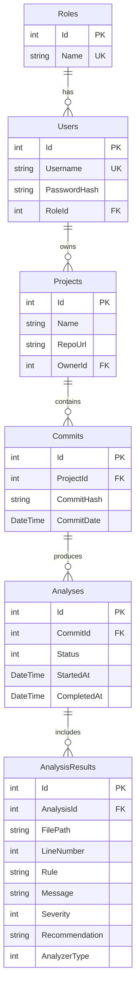

# Исполнительное резюме проекта

## 1. Назначение и архитектура системы
Проект представляет собой модульную систему комплексного статического анализа C#/.NET-проектов и связанных схем баз данных Entity Framework Core. Архитектура построена по принципам чистой слоистой архитектуры (Clean/Layered Architecture) в виде модульного монолита на платформе ASP.NET Core (.NET 10).

### Архитектурные слои:
- **Domain (`src/Backend/Domain`):** сущности предметной области (`Role`, `User`, `Project`, `Commit`, `Analysis`, `AnalysisResult`), доменные перечисления (`AnalysisStatus`, `AnalyzerType`, `Severity`) и базовые правила целостности. Не зависит от внешних библиотек и СУБД.
- **Application (`src/Backend/Application`):** прикладные службы оркестрации анализа (`AnalysisService`), сервисы управления проектами и коммитами, контракты репозиториев (`IProjectRepository`, `IAnalysisRepository` и др.), DTO и интерфейс взаимодействия анализаторов `IAnalyzer`.
- **Infrastructure (`src/Backend/Infrastructure`):** реализация доступа к базе данных PostgreSQL 17 через Entity Framework Core (`AppDbContext`), миграции, реализация репозиториев, сервис безопасного хэширования паролей (`PasswordHasher` на BCrypt), выпуск JWT-токенов (`JwtTokenService`) и взаимодействие с GitHub REST API (`GitHubService`, `RepositorySourceService`).
- **Api (`src/Backend/Api`):** HTTP REST API контроллеры, настройка авторизации JWT Bearer, регистрация зависимостей в DI-контейнере и автоматическая генерация документации Swagger UI (OpenAPI 3.0).
- **Модули анализаторов (`src/Analyzers/*`):** независимые библиотеки классов, подключаемые через общий контракт `IAnalyzer`.

---

## 2. Доменные сущности и схема базы данных

Схема базы данных спроектирована в третьей нормальной форме (3НФ) в СУБД PostgreSQL. Имена таблиц и столбцов строго следуют правилу `PascalCase` в двойных кавычках, а таблицы именуются во множественном числе в полном соответствии с миграциями EF Core и нормативом `docs/Правила-базы-данных.txt`.

### Доменные сущности и атрибуты

| Сущность | Поле | Тип | Null? | Описание |
| :--- | :--- | :--- | :---: | :--- |
| **Role** | `Id` | `int` | Нет | Первичный ключ роли (IDENTITY). |
| | `Name` | `string` | Нет | Уникальное наименование роли (`Admin`, `User`). |
| **User** | `Id` | `int` | Нет | Первичный ключ пользователя (IDENTITY). |
| | `Username` | `string` | Нет | Уникальное имя пользователя (логин). |
| | `PasswordHash` | `string` | Нет | Хэш пароля (BCrypt). |
| | `RoleId` | `int` | Нет | Внешний ключ на роль пользователя (`Roles.Id`). |
| **Project** | `Id` | `int` | Нет | Первичный ключ проекта (IDENTITY). |
| | `Name` | `string` | Нет | Наименование проекта. |
| | `RepoUrl` | `string` | Нет | URL удаленного репозитория GitHub. |
| | `OwnerId` | `int` | Нет | Внешний ключ на владельца проекта (`Users.Id`). |
| **Commit** | `Id` | `int` | Нет | Первичный ключ коммита (IDENTITY). |
| | `ProjectId` | `int` | Нет | Внешний ключ на проект (`Projects.Id`). |
| | `CommitHash` | `string` | Нет | Хэш коммита в Git (SHA-1 / SHA-256). |
| | `CommitDate` | `DateTime` | Нет | Дата и время создания коммита. |
| **Analysis** | `Id` | `int` | Нет | Первичный ключ сессии анализа (IDENTITY). |
| | `CommitId` | `int` | Нет | Внешний ключ на анализируемый коммит (`Commits.Id`). |
| | `Status` | `AnalysisStatus` | Нет | Статус анализа (`Pending`, `Running`, `Completed`, `Failed`). |
| | `StartedAt` | `DateTime` | Нет | Дата и время запуска сессии анализа. |
| | `CompletedAt` | `DateTime?` | Да | Дата и время завершения сессии анализа. |
| **AnalysisResult** | `Id` | `int` | Нет | Первичный ключ записи о нарушении (IDENTITY). |
| | `AnalysisId` | `int` | Нет | Внешний ключ на сессию анализа (`Analyses.Id`). |
| | `FilePath` | `string` | Нет | Путь к файлу с выявленным дефектом (или имя сущности/таблицы). |
| | `LineNumber` | `int` | Нет | Номер строки в файле (0, если дефект уровня схемы/модели). |
| | `Rule` | `string` | Нет | Идентификатор сработавшего правила (`CSHARP001`, `DB01` и т.д.). |
| | `Message` | `string` | Нет | Детальное описание выявленного нарушения. |
| | `Severity` | `Severity` | Нет | Уровень критичности замечания (`Info`, `Warning`, `Error`, `Critical`). |
| | `Recommendation`| `string?` | Да | Рекомендация по исправлению дефекта. |
| | `AnalyzerType` | `AnalyzerType` | Нет | Тип анализатора (`CSharp`, `Database`, `Sql`, `Security`). |

---

## 3. ER-диаграмма базы данных



---

## 4. DDL схемы PostgreSQL (актуальное состояние миграций)

```sql
CREATE TABLE "Roles" (
    "Id"   INTEGER GENERATED BY DEFAULT AS IDENTITY PRIMARY KEY,
    "Name" TEXT NOT NULL
);
CREATE UNIQUE INDEX "IX_Roles_Name" ON "Roles" ("Name");

CREATE TABLE "Users" (
    "Id"           INTEGER GENERATED BY DEFAULT AS IDENTITY PRIMARY KEY,
    "Username"     TEXT NOT NULL,
    "PasswordHash" TEXT NOT NULL,
    "RoleId"       INTEGER NOT NULL,
    CONSTRAINT "FK_Users_Roles_RoleId" FOREIGN KEY ("RoleId")
        REFERENCES "Roles" ("Id") ON DELETE RESTRICT
);
CREATE UNIQUE INDEX "IX_Users_Username" ON "Users" ("Username");
CREATE INDEX "IX_Users_RoleId" ON "Users" ("RoleId");

CREATE TABLE "Projects" (
    "Id"      INTEGER GENERATED BY DEFAULT AS IDENTITY PRIMARY KEY,
    "Name"    TEXT NOT NULL,
    "RepoUrl" TEXT NOT NULL,
    "OwnerId" INTEGER NOT NULL,
    CONSTRAINT "FK_Projects_Users_OwnerId" FOREIGN KEY ("OwnerId")
        REFERENCES "Users" ("Id") ON DELETE RESTRICT
);
CREATE UNIQUE INDEX "IX_Projects_OwnerId_Name" ON "Projects" ("OwnerId", "Name");
CREATE INDEX "IX_Projects_OwnerId" ON "Projects" ("OwnerId");

CREATE TABLE "Commits" (
    "Id"         INTEGER GENERATED BY DEFAULT AS IDENTITY PRIMARY KEY,
    "ProjectId"  INTEGER NOT NULL,
    "CommitHash" TEXT NOT NULL,
    "CommitDate" TIMESTAMP WITH TIME ZONE NOT NULL,
    CONSTRAINT "FK_Commits_Projects_ProjectId" FOREIGN KEY ("ProjectId")
        REFERENCES "Projects" ("Id") ON DELETE CASCADE
);
CREATE UNIQUE INDEX "IX_Commits_ProjectId_CommitHash" ON "Commits" ("ProjectId", "CommitHash");
CREATE INDEX "IX_Commits_ProjectId" ON "Commits" ("ProjectId");

CREATE TABLE "Analyses" (
    "Id"          INTEGER GENERATED BY DEFAULT AS IDENTITY PRIMARY KEY,
    "CommitId"    INTEGER NOT NULL,
    "Status"      INTEGER NOT NULL,
    "StartedAt"   TIMESTAMP WITH TIME ZONE NOT NULL,
    "CompletedAt" TIMESTAMP WITH TIME ZONE NULL,
    CONSTRAINT "FK_Analyses_Commits_CommitId" FOREIGN KEY ("CommitId")
        REFERENCES "Commits" ("Id") ON DELETE CASCADE
);
CREATE INDEX "IX_Analyses_CommitId" ON "Analyses" ("CommitId");

CREATE TABLE "AnalysisResults" (
    "Id"             INTEGER GENERATED BY DEFAULT AS IDENTITY PRIMARY KEY,
    "AnalysisId"     INTEGER NOT NULL,
    "FilePath"       TEXT NOT NULL,
    "LineNumber"     INTEGER NOT NULL,
    "Rule"           TEXT NOT NULL,
    "Message"        TEXT NOT NULL,
    "Severity"       INTEGER NOT NULL,
    "Recommendation" TEXT NULL,
    "AnalyzerType"   INTEGER NOT NULL,
    CONSTRAINT "FK_AnalysisResults_Analyses_AnalysisId" FOREIGN KEY ("AnalysisId")
        REFERENCES "Analyses" ("Id") ON DELETE CASCADE
);
CREATE INDEX "IX_AnalysisResults_AnalysisId" ON "AnalysisResults" ("AnalysisId");
```

---

## 5. Доменные перечисления (Enums)

Все доменные перечисления хранятся в PostgreSQL как целочисленные значения (`INTEGER`, числовые коды 0, 1, 2...).

- **`AnalysisStatus` (`Domain.Enums.AnalysisStatus`):**
  - `Pending` (0) — задача анализа ожидает обработки в очереди;
  - `Running` (1) — анализ выполняется модулями;
  - `Completed` (2) — анализ успешно завершен, результаты сохранены;
  - `Failed` (3) — при выполнении анализа произошла ошибка.
- **`Severity` (`Domain.Enums.Severity`):**
  - `Info` (0) — информационная рекомендация по улучшению стиля/структуры;
  - `Warning` (1) — потенциальная проблема, не нарушающая работоспособность, но ухудшающая качество;
  - `Error` (2) — критическое нарушение проектных правил или соглашений;
  - `Critical` (3) — фатальный дефект схемы или кода (например, отсутствие первичного ключа).
- **`AnalyzerType` (`Domain.Enums.AnalyzerType`):**
  - `CSharp` (0) — статический анализ кода C# (Roslyn);
  - `Database` (1) — анализ метаданных моделей EF Core;
  - `Sql` (2) — статический анализ LINQ/SQL обращений;
  - `Security` (3) — анализ безопасности и уязвимостей.

---

## 6. Контракты API и маршрутизация

Маршруты API соответствуют спецификации OpenAPI 3.0 (`swagger.json`).

### Аутентификация и пользователи (`AuthController`, `AdminUsersController`)
- `POST /api/auth/register` — регистрация новой учетной записи (`RegisterDto` → `AuthResponseDto`).
- `POST /api/auth/login` — вход и получение JWT Bearer токена (`LoginDto` → `AuthResponseDto`).
- `PUT /api/auth/me/username` — смена собственного имени пользователя (`ChangeUsernameDto`).
- `PUT /api/auth/me/password` — смена пароля (`ChangePasswordDto`).
- `GET /api/admin/users` — список всех пользователей (роль `Admin`).
- `GET /api/admin/users/{id}` — получение пользователя по ID (роль `Admin`).
- `PUT /api/admin/users/{id}` — обновление данных пользователя (роль `Admin`).
- `DELETE /api/admin/users/{id}` — удаление пользователя (роль `Admin`).
- `PUT /api/admin/users/{id}/role` — изменение роли пользователя (`UpdateUserRoleDto`, роль `Admin`).

### Управление проектами (`ProjectsController`)
- `GET /api/projects` — список проектов текущего пользователя (или всех для `Admin`).
- `POST /api/projects` — создание проекта (`CreateProjectDto` → `ProjectDto`, `201 Created`).
- `GET /api/projects/{id}` — получение сведений о проекте по ID.
- `PUT /api/projects/{id}` — обновление параметров проекта (`UpdateProjectDto`).
- `DELETE /api/projects/{id}` — удаление проекта (`204 No Content`).
- `GET /api/projects/owner/{ownerId}` — получение проектов конкретного пользователя.
- `POST /api/projects/{projectId}/github/sync` — синхронизация списка коммитов из GitHub API (`GitHubSyncResultDto`).

### Коммиты проекта (`CommitsController`)
- `GET /api/projects/{projectId}/commits` — получение коммитов проекта.
- `POST /api/projects/{projectId}/commits` — ручная регистрация коммита (`CreateCommitDto` → `CommitDto`, `201 Created`).
- `GET /api/projects/{projectId}/commits/{id}` — получение коммита по ID.

### Анализы коммитов (`AnalysesController`)
- `POST /api/projects/{projectId}/commits/{commitId}/analyses` — инициация комплексного анализа коммита:
  - *Текущая реализация в коде:* синхронное выполнение в HTTP-запросе, возвращает `200 OK` с `AnalysisDto` (содержит полный массив результатов `Results`).
  - *Целевое поведение MVP:* создание записи `Analysis` со статусом `Pending`, сохранение в PostgreSQL, возврат `202 Accepted` с `AnalysisDto` (`Status = Pending`), фоновая обработка воркером `BackgroundService`.
- `GET /api/projects/{projectId}/commits/{commitId}/analyses` — получение истории анализов коммита (`IReadOnlyList<AnalysisDto>`).
- `GET /api/projects/{projectId}/commits/{commitId}/analyses/{analysisId}` — детальные сведения об анализе со списком нарушений `Results`.

---

## 7. Модули анализаторов

Все анализаторы подключаются через унифицированный интерфейс `IAnalyzer`:
```csharp
public interface IAnalyzer
{
    AnalyzerType Type { get; }
    Task<IReadOnlyList<AnalyzerFinding>> AnalyzeAsync(
        AnalyzerContext context,
        CancellationToken cancellationToken = default);
}
```

### 1. CSharpAnalyzer (`src/Analyzers/CSharp`) — Реализован
Статический анализ исходного кода C# с использованием Microsoft.CodeAnalysis.CSharp (Roslyn). Анализирует синтаксические деревья (AST) исходных файлов, игнорируя служебные каталоги (`bin`, `obj`, `.git` и др.).
- `CSHARP001` (`LargeClassRule`, `Severity.Warning`): выявление классов, размер которых превышает 500 строк кода.
- `CSHARP002` (`LongMethodRule`, `Severity.Warning`): выявление методов, размер которых превышает 50 строк кода.

### 2. DatabaseAnalyzer (`src/Analyzers/Database`) — Реализован
Анализ метаданных объектной модели Entity Framework Core целевого проекта. Не требует подключения к рабочей СУБД; использует компиляцию проекта на этапе сборки и инспекцию проектной модели `IModel`.
- `DB01` (`Severity.Warning`): сущность не имеет определенного первичного ключа.
- `DB02` (`Severity.Warning`): внешний ключ не имеет навигационного свойства к главной сущности (рекомендация проектного соглашения).
- `DB03` (`Severity.Info`): неявная связь многие-ко-многим между сущностями через неявную промежуточную таблицу (рекомендация создания явной join entity).
- `DB04` (`Severity.Warning`): внешний ключ не имеет подходящего покрывающего индекса.
- `DB05` (`Severity.Info`): обнаружены дублирующиеся индексы по одинаковому набору столбцов.

### 3. SqlAnalyzer (`src/Analyzers/Sql`) — Целевой компонент MVP
Статический анализ C# кода обращения к базе данных с помощью Roslyn (без динамического перехвата запросов в runtime).
- `SQL001` (`Severity.Warning`): потенциально небезопасное формирование SQL-запросов через строковую интерполяцию или конкатенацию в небезопасных методах EF Core (`FromSqlRaw`, `ExecuteSqlRaw`).
- `SQL002` (`Severity.Info`): явное использование конструкции `SELECT *` в строковых SQL-запросах, передаваемых методам выполнения SQL.

### 4. SecurityAnalyzer (`src/Analyzers/Security`) — Перспектива развития
Статический аудит безопасности: поиск открытых секретов, токенов, опасных настроек CORS и известных уязвимостей в зависимостях.

---

## 8. Клиентские приложения и дистрибуция

Клиентские приложения входят в состав общей архитектуры монорепозитория, но не содержат собственной бизнес-логики анализа и подключаются к системе строго через HTTP REST API:
- **Расположение исходного кода:** каталоги `src/Cli`, `src/Desktop`, `src/Bot` монорепозитория CourseProject являются зарезервированными каталогами для клиентских интерфейсов (в текущей кодовой базе проекты клиентов не подключены в решение `CourseProject.slnx`). Единственным фактически работающим интерактивным клиентом является встроенный **Swagger UI** (`/swagger`).
- **Публикация и дистрибуция:** внешние публичные репозитории GitHub используются как зеркала для независимой публикации готовых сборок клиентов, чтобы пользователи могли скачивать их и использовать без развертывания всего репозитория.
- **Статус клиентов:**
  - `src/Cli` (.NET 10 / Spectre.Console) — консольный клиент целевого MVP для автоматизации запуска анализов и CI-сценариев (каталог зарезервирован, проект планируется к реализации).
  - `src/Desktop` (Tauri + React + TypeScript) — кроссплатформенный графический интерфейс (каталог зарезервирован, планируемый компонент).
  - `src/Bot` (.NET / Telegram.Bot) — чат-бот для оперативных оповещений и команд (каталог зарезервирован, планируемый компонент).

---

## 9. Развертывание и инфраструктура

- **СУБД:** PostgreSQL 17 развертывается в контейнере Docker через `docker-compose.yml` (порт `5433:5432`, постоянное хранилище `postgres_data`).
- **Среда выполнения:** .NET 10 SDK, кроссплатформенная поддержка (Linux, Windows, macOS).
- **Миграции:** автоматическое управление версиями схемы через EF Core Migrations в проекте `Infrastructure`.
- **Тестирование:** автоматизированные наборы тестов на базе xUnit (`CSharpAnalyzer.Tests` — 12 тестов, `DatabaseAnalyzer.Tests` — 59 тестов).
